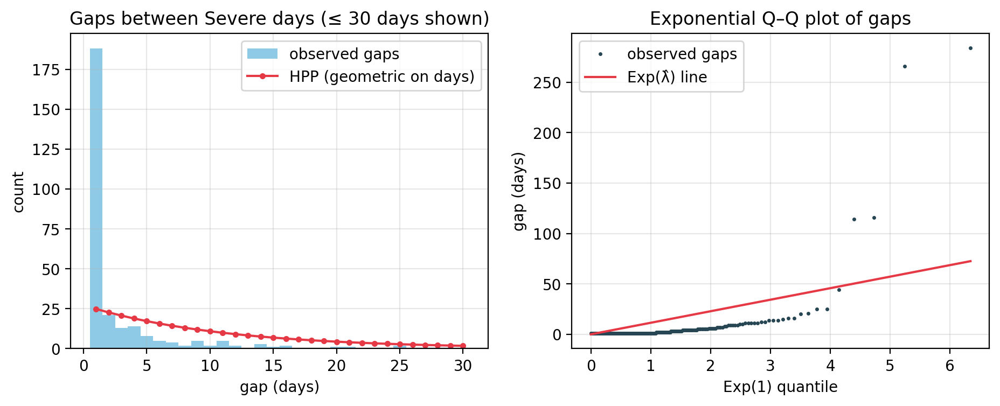
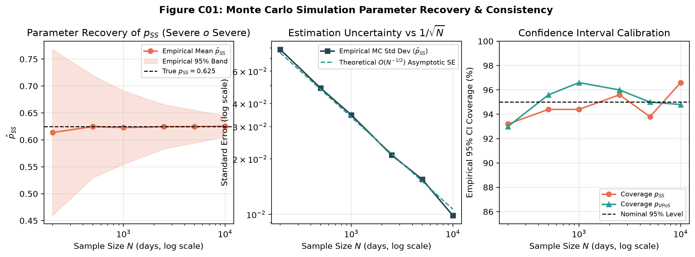
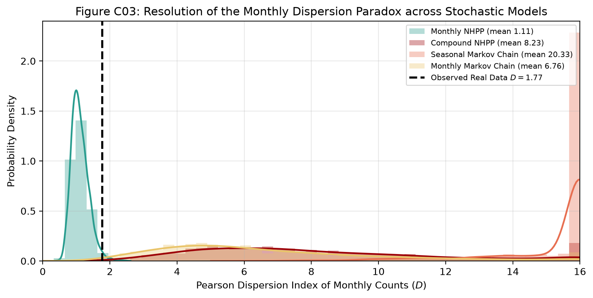
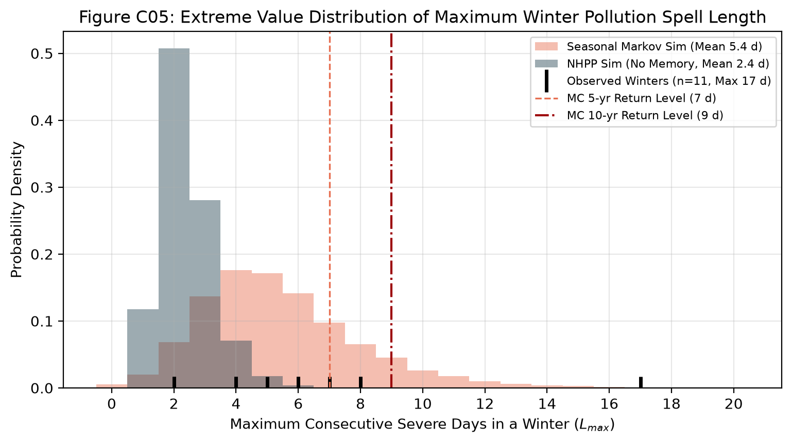
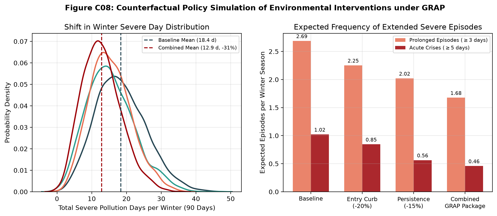

# Stochastic Modelling of Severe Air-Pollution Days in Delhi

## ASM Project Report — 2026M

**Team:** Harsh Raj (data and Poisson process) · Vivian (Markov chain) · Rudraksh Kapil (simulation and validation)
**Application Domain:** Environmental Science / Urban Air Quality Management
**Data Source:** Central Pollution Control Board (CPCB), CAAQMS Data Repository — R K Puram, Delhi (DPCC, Site 124)
**Study Period:** 2016–2025 (with 2026 hold-out) · **Code:** github.com/HarshRaj797864/asm-air-pollution (notebooks 01–04)

---

## 1. Problem Statement

On a **Severe** air-quality day in Delhi, the 24-hour mean PM2.5 is above 250 µg/m³: the top category of India's National AQI, more than four times the national 24-hour limit of 60 µg/m³, and the level at which emergency measures under the **Graded Response Action Plan (GRAP)** are triggered. Whether a day turns Severe depends on wind, temperature inversions, crop-residue burning, festival fireworks and traffic, none of which can be predicted exactly, so we model Severe days as a **stochastic process**.

> [!IMPORTANT]
> **Research questions:** (1) At what rate do Severe days occur, does the rate depend on the season, and has it changed over 2016–2025? (2) Are Severe days independent events (a Poisson process) or do they cluster? (3) How does air quality move between categories from day to day, and how long do Severe spells last? (4) How well do models fitted on past years predict later years? (5) What could GRAP-style measures change, under assumed effect sizes?

---

## 2. Data and Exploratory Analysis

**Source and cleaning.** Hourly PM2.5 from the CPCB CAAQMS repository ([airquality.cpcb.gov.in/ccr](https://airquality.cpcb.gov.in/ccr/)), R K Puram (site 124), one file per year for 2009–2026. Readings at the analyser cap (1000 µg/m³, 17 hours) were set to missing. A day is *observed* if at least 18 of its 24 hours are valid; gaps of up to 3 days are interpolated (194 days, 5.3%) and longer gaps are left out of the exposure time (223 days, 6.1%). Earlier years are sparse (2014 has no data), so models are fitted on **2016–2025: 3,653 days, 3,430 valid**, every year at least 72% observed. January–September 2026 is kept as an extra hold-out.

PM2.5 has a strong annual cycle: lowest in July–August (monsoon washout), highest in November–January (inversions, crop burning, fireworks). The valid-day mean is 111.9 µg/m³, the median 83.9 and the maximum 729.3 (6 November 2016).

**Event definition.** An *event* is a Severe day (PM2.5 > 250 µg/m³). Lower thresholds are not rare events, so they do not suit a counting process:

| Threshold (µg/m³) | Event days | % of valid days | Episodes | Mean episode length |
|---|---|---|---|---|
| 60 | 2,231 | 65.0% | 185 | 12.1 days |
| 120 | 1,186 | 34.6% | 160 | 7.4 days |
| **250 (Severe)** | **300** | **8.7%** | **112** | **2.7 days** |

The 300 Severe days form 112 episodes (runs of consecutive Severe days); the longest lasted **17 days** from 20 December 2018. For the Markov chain each day is also given its AQI band: Good/Satisfactory 35.0%, Moderate 18.1%, Poor 12.4%, Very Poor 25.8%, Severe 8.7%.

---

## 3. Model I — Poisson Process (Harsh Raj)

### 3.1 Formulation and Estimation

$N(t)$ counts Severe days in $(0, t]$, with $t$ in days. A **homogeneous Poisson process (HPP)** with rate $\lambda$ has independent stationary increments, $N(t) \sim \text{Poisson}(\lambda t)$, $E[N(t)] = \text{Var}[N(t)] = \lambda t$, and i.i.d. $\text{Exp}(\lambda)$ gaps. A **non-homogeneous** process (NHPP) has monthly rates $\lambda(t) = \lambda_{m(t)}$, so $N(t) \sim \text{Poisson}(\Lambda(t))$ with $\Lambda(t) = \int_0^t \lambda(s)\,ds$. A **compound NHPP** lets episodes start at rate $\mu_{m(t)}$ and last $L \sim \text{Geometric}(1-q)$ days. With daily data at most one event is seen per day; for small rates a Bernoulli day process is close to Poisson (law of rare events), less so in winter.

The MLE is $\hat{\lambda} = n/T$ with the exact (Garwood) interval $\left[\chi^2_{0.025,2n}/2T,\; \chi^2_{0.975,2n+2}/2T\right]$. With $n = 300$ and $T = 3{,}430$:

$$\hat{\lambda} = 0.0875 \text{ per day} \;(0.078\text{–}0.098) \;\approx\; 31.9 \text{ Severe days per year} \;(28.4\text{–}35.8)$$

### 3.2 The HPP is Rejected

Monthly counts have mean 2.5 and variance 21.4: a Pearson dispersion index of **8.1** where a Poisson process needs about 1 ($\chi^2 = 965$, df = 119). **66% of gaps between Severe days are a single day**, against 9% expected under the HPP (KS $D = 0.58$, $p \approx 10^{-93}$).

### 3.3 Seasonality is the Main Effect

November (0.345 per day), December (0.312) and January (0.296) hold **94% of Severe days (281 of 300)**, about one day in three; March–September had three Severe days in ten years.

| Model | Parameters | Log-likelihood | AIC | Dispersion |
|---|---|---|---|---|
| HPP | 1 | −462.8 | 927.6 | 8.11 |
| Seasonal NHPP | 4 | −217.7 | 443.3 | 3.45 |
| **Monthly NHPP** | **12** | **−122.9** | **269.8** | **1.77** |

The likelihood-ratio test of the HPP against the monthly NHPP gives LR = 680 (df 11, $p < 10^{-30}$). A Poisson regression with month and year effects finds **no trend**: −0.4% per year (95% CI −5.6% to +5.0%; quasi-Poisson $\hat{\phi} = 1.54$, year effect $p = 0.10$).

### 3.4 Clustering Remains

**63% of Severe days (188 of 300) follow another Severe day.** Episode *onsets* behave like a Poisson process (dispersion 0.89, $p = 0.71$), and episode lengths are roughly geometric with $\hat{q} = 0.627$ (chi-square $p = 0.018$). The time-rescaling theorem confirms this: rescaled gaps should be i.i.d. Exp(1), and the KS distance falls from 0.51 (HPP) to 0.23 (NHPP, $p \approx 10^{-14}$) for Severe days, and to 0.17 ($p = 0.004$) for episode onsets. Seasonality is fixed by the NHPP; clustering is not, which motivates the Markov chain.

### 3.5 Out-of-Sample Test (Fitted on 2016–2022)

| Year | Observed | HPP 95% PI | Monthly NHPP 95% PI | Compound 95% PI |
|---|---|---|---|---|
| 2023 | 44 | 18–39 ✗ | 19–40 ✗ | 9–51 ✓ |
| 2024 | 34 | 19–39 ✓ | 18–40 ✓ | 10–53 ✓ |
| 2025 | 35 | 19–39 ✓ | 18–39 ✓ | 9–54 ✓ |
| 2026 (Jan–Sep) | 7 | 13–31 ✗ | 5–17 ✓ | 0–25 ✓ |

Over 45 test months the monthly NHPP has the best log score (−0.99; HPP −3.36, compound −1.05), the lowest mean absolute error (1.09) and 95.6% interval coverage. Its only miss is the bad winter of 2023.

---

## 4. Model II — Markov Chain (Vivian)

### 4.1 Formulation and Estimation

$\{X_n\}$ is today's AQI band on 5 states (Good and Satisfactory merged), a first-order chain with $P(X_{n+1} = j \mid X_n = i, \ldots) = p_{ij}$. The MLE is $\hat{p}_{ij} = n_{ij}/n_i$. Standard results used: $P^{(n)} = P^n$ (Chapman–Kolmogorov); the stationary distribution solves $\pi = \pi P$; spells in state $i$ are $\text{Geometric}(1 - p_{ii})$ with mean $1/(1-p_{ii})$; mean first-passage times to Severe are $m = (I - Q)^{-1}\mathbf{1}$.

From 3,394 transitions the diagonal dominates (Good/Satisfactory 0.86, Moderate 0.52, Poor 0.45, Very Poor 0.72, Severe 0.63), and only 3.5% of days move two or more bands. Severe is entered almost only from Very Poor (0.12) and left almost only to Very Poor (0.34).

> [!NOTE]
> **Consistency check:** $\hat{p}_{SS} = 188/298 = 0.631$ (95% CI 0.575–0.684), close to the Poisson episode estimate $\hat{q} = 188/300 = 0.627$. They agree because both count the same 188 Severe-to-Severe days, so this confirms the two analyses are consistent; it is not independent evidence. The implied mean spell $1/(1-0.631) = 2.71$ days matches the observed 2.68.

### 4.2 Seasons and Memory

Transition matrices differ between seasons ($G^2 = 347$, df = 54, $p \approx 10^{-44}$; winter vs summer $p \approx 10^{-20}$), so a matrix is fitted per season. In winter, Very Poor → Severe is 0.14 against 0.01 in summer: seasons change how easily the chain **enters** Severe, not how long it **stays**. Starting from a Severe winter day, $P^n$ gives:

| Days ahead | 1 | 2 | 3 | 7 | 14 | 30 |
|---|---|---|---|---|---|---|
| $P(\text{Severe})$ | 0.63 | 0.44 | 0.34 | 0.23 | 0.21 | 0.21 |

Memory fades within about a week (second eigenvalue 0.70 in winter). The winter stationary distribution gives $\pi_{\text{Severe}} = 0.206$ against 0.214 observed: **one winter day in five is Severe**. All-year, $1/\pi_5 = 11.5$ days, essentially the same quantity as the Poisson mean gap $1/\hat{\lambda} = 11.4$. Geometric spell means match the observed means for all five states (Severe 2.7 vs 2.7).

**Order of the chain.** Within winter, a second-order chain adds nothing (Anderson–Goodman $G^2 = 39.8$, df = 45, $p = 0.69$; post-monsoon $p = 0.09$), and BIC picks order 1; the pooled test rejects order 1 only because it mixes seasons. Two Severe days in a row do not make a third more likely (0.65 vs 0.61, Fisher $p = 0.53$).

### 4.3 When the Smog Season Starts

Using monthly matrices from 1 October with Severe made absorbing, the chain predicts the first Severe day after about **29 days** from a Moderate start (the usual 1 October state). In the 10 observed seasons it came after 19–37 days (**mean 29.6**), and all 10 seasons had one by 15 November (model: 87–93%). Real start dates are more tightly bunched than predicted, because one October matrix spreads the late-October Diwali and crop-burning spike over the whole month.

### 4.4 Next-Day Forecasts (Fitted on 2016–2022, Tested on 2023–Sep 2026)

| Model | Mean log score | Accuracy | Brier $P(\text{Severe})$ |
|---|---|---|---|
| Monthly category frequencies | −1.042 | 0.551 | 0.0598 |
| Order 1, all-year | −0.903 | 0.647 | 0.0521 |
| **Order 1, seasonal** | **−0.853** | **0.646** | **0.0508** |
| Order 2, seasonal | −0.898 | 0.630 | 0.0509 |
| Monthly NHPP (Section 3) | — | — | 0.0598 |

The seasonal first-order chain gives the best next-day forecasts because it uses today's state.

---

## 5. Model III — Simulation Engine & Validation (Rudraksh Kapil)

### 5.1 Engine Design & Parameter Recovery

Rudraksh Kapil combined both models in one Python simulation engine (`StochasticAirQualitySimulator`, notebook 04). It simulates the HPP, monthly and compound NHPPs, and all-year, seasonal and monthly Markov chains on the real 3,653-day calendar with its missing-day mask. Markov paths are advanced for all replications at once by inverse-CDF sampling: take each path's row of today's matrix, form its cumulative sum, and pick the first state whose cumulative probability exceeds a uniform draw.

Monte Carlo parameter recovery (500 replicates per size, true $p_{SS} = 0.625$, $N$ = 200 to 10,000) confirms the estimator behaves as theory predicts: the bias vanishes (mean estimate 0.614 at $N = 200$, 0.625 at $N = 10{,}000$), the standard deviation falls roughly as $N^{-1/2}$ (0.079 → 0.010), and 95% interval coverage stays between 93.2% and 96.6%, within Monte Carlo error of the nominal level.

### 5.2 Comparative Simulation: Monthly Dispersion

Each model was replayed **2,000 times** on the 2016–2025 calendar. All reproduce the ten-year total of about 300 Severe days, but they differ sharply in month-to-month variation, measured by the dispersion index $D = \frac{1}{M-k}\sum_m (n_m - \mu_m)^2/\mu_m$ (observed $D_{\text{obs}} = 1.77$):

| Model | Simulated total (95% range) | Monthly $D$ (mean, 95% range) | $P(D_{\text{sim}} \ge 1.77)$ | Verdict |
|---|---|---|---|---|
| HPP | 300 (267–336) | 10.6 (7.2–15.2) | 1.000 | Ignores seasonality |
| Monthly NHPP | 301 (269–334) | 1.1 (0.7–1.7) | 0.015 | Too regular: no clustering |
| Compound NHPP | 300 (231–379) | 8.2 (3.0–18.9) | 1.000 | Far too variable |
| Seasonal Markov chain | 287 (228–345) | 20.3 (9.9–35.1) | 1.000 | Far too variable |
| Monthly Markov chain | 299 (245–354) | 6.8 (2.4–15.8) | 0.996 | Too variable |

**No model reproduces the observed dispersion.** The NHPP assumes independent days, so its monthly counts are too steady. A first-order chain has lag-$k$ autocorrelation $\rho^k$ with $\rho = p_{SS} - p_{\bar{S}S} \approx 0.53$ in winter, which inflates monthly variance by roughly $(1+\rho)/(1-\rho) \approx 3.2$: whole spells pile into single months. Real Severe days cluster within spells, but the spells are spread more evenly across a winter than a simple chain expects, which points to winter-to-winter variation in the intensity itself (a Cox process or hidden regimes).

### 5.3 Episode Lengths & Extreme Spells

Markov-simulated episode lengths match the 112 real episodes: mean 2.64 days against 2.68, and a two-sample KS test cannot tell them apart ($D = 0.089$, $p = 0.32$). The compound NHPP's episode lengths are not compared, because in the current code all of an episode's days are placed on its onset day.

For the longest Severe run of each December–February winter (11 real winters; 20,000 simulated winters per model, the chain started from its winter stationary distribution):

| Longest Dec–Feb run | Real winters (n = 11) | Winter Markov chain | Monthly NHPP |
|---|---|---|---|
| Mean | 6.3 days | 5.9 days | 3.2 days |
| $P(\ge 7 \text{ days})$ | 36% (4 of 11) | 33% | 1.0% |
| $P(\ge 10 \text{ days})$ | 9% (1 of 11) | 8.6% | 0.04% |

Without memory, a week-long Severe crisis happens in about 1% of winters; the Markov chain gives 33%, close to the observed 4 of 11. The chain still makes the 17-day record (from 20 December 2018) a roughly 1-in-400-winter event, so the real tail is heavier than either model. With only 11 winters we do not estimate return levels beyond the length of the record.

### 5.4 Multi-Step Forecast Verification (2023–Sep 2026)

Both models were refitted on 2016–2022 and scored on every day of 2023–September 2026 (about 1,300 forecasts per horizon). The Markov forecast uses Chapman–Kolmogorov, $P(X_{t+h} = \text{Severe} \mid X_t = i) = [P_{\text{season}}^h]_{i,\text{Severe}}$; the NHPP forecast is the target month's rate.

| Horizon $h$ | Brier (Markov) | Brier (NHPP) | Skill vs climatology (Markov / NHPP) | AUC (Markov) | AUC (NHPP) |
|---|---|---|---|---|---|
| 1 day | **0.051** | 0.060 | **38%** / 27% | **0.931** | 0.897 |
| 3 days | 0.062 | **0.060** | 24% / **27%** | **0.900** | 0.895 |
| 7 days | 0.067 | **0.058** | 16% / **27%** | 0.871 | **0.894** |
| 14 days | 0.068 | **0.058** | 14% / **27%** | 0.814 | **0.895** |

The Markov chain has the lower Brier score **only one day ahead** (from two days on the NHPP is better) and ranks days better (higher AUC) up to three days ahead. Because $P^h \to \pi$ within about a week, the chain forgets today's state, while the NHPP keeps finer monthly detail. Both beat climatology at every horizon.

### 5.5 GRAP Policy Scenarios (Assumed Effects)

3,000 independent 90-day winters were simulated with the winter matrix under modified transition probabilities. **The effect sizes are assumptions chosen to show the mechanism, not estimates of what GRAP achieves.**

| Scenario | Severe days (mean) | Change | 5-day crises per winter | $P(\ge 1 \text{ crisis})$ |
|---|---|---|---|---|
| Baseline | 18.4 | — | 1.02 | 66.3% |
| Entry curb (−20% Very Poor → Severe) | 15.5 | −16% | 0.85 (−17%) | 58.8% |
| Persistence curb (−15% Severe → Severe) | 15.4 | −16% | 0.56 (−45%) | 44.3% |
| Combined | 12.9 | −30% | 0.46 (−55%) | 37.7% |

> [!IMPORTANT]
> **Mechanism, not forecast:** for a similar cut in total Severe days, reducing persistence removes about 45% of 5-day crises, about 2.6 times the effect of the entry curb, because persistence multiplies into every extra day of a spell. Combined, the assumed measures cut Severe days by 30% and the chance of a 5-day crisis from 66% to 38%. Real effect sizes would have to be estimated, for example from GRAP activation dates.

---

## 6. Comparison of Theoretical and Empirical Results

### 6.1 Cross-Model Consistency

| Quantity | Poisson (Harsh Raj) | Markov (Vivian) | Simulation (Rudraksh Kapil) |
|---|---|---|---|
| $P(\text{Severe} \mid \text{Severe})$ | $\hat{q} = 188/300 = 0.627$ | $\hat{p}_{SS} = 188/298 = 0.631$ | Recovered without bias (5.1) |
| Mean Severe spell | 2.68 days | 2.71 days | 2.64 days (simulated) |
| Mean recurrence time | $1/\hat{\lambda} = 11.4$ days | $1/\pi_5 = 11.5$ days | — |
| Annual Severe days | 31.9 per year | $365\,\pi_5 = 31.7$ | 300.7 per 10 years (NHPP) |

The Poisson and Markov columns agree because they are computed from the same 300 Severe days, so they confirm the analyses are consistent rather than giving independent evidence. The genuinely independent checks are the theoretical predictions tested against data below.

### 6.2 Where Theory Matches and Where It Diverges

| Theoretical prediction | Empirical result | Status |
|---|---|---|
| Geometric spells, $E[D] = 1/(1-p_{ii})$ | Matches observed means for all 5 states | ✓ |
| Stationary distribution $\pi = \pi P$ | Within 1% of observed frequencies | ✓ |
| $P^n \to \pi$ (winter eigenvalue 0.70) | Memory gone within a week; explains the forecast crossover | ✓ |
| NHPP 95% monthly intervals | 95.6% coverage on 45 unseen months | ✓ |
| First-order chain within seasons | Anderson–Goodman $p = 0.69$ (winter) | ✓ |
| First Severe day about 29 days after 1 October | Observed mean 29.6 days | ✓ |
| MLE standard error $\propto N^{-1/2}$ | Confirmed by parameter recovery | ✓ |
| Markov episode lengths | KS $p = 0.32$ against real episodes | ✓ |
| Monthly dispersion (NHPP 1.1, Markov 6.8) | $D_{\text{obs}} = 1.77$ | ✗ neither model |
| Geometric spell shape, $P(L \ge 3) = 0.39$ | Observed 0.30 (chi-square $p = 0.018$); record 17 days | ✗ shape and extreme tail |
| NHPP 2023 interval 19–40 | Observed 44 (and 16 in 2022) | ✗ year-to-year variation |

The remaining dispersion, the extreme tail and the year-to-year swings all point to winter-to-winter meteorological variation and latent regimes that stationary models do not capture.

### 6.3 Model Selection Guide

| Decision question | Best model | Rationale |
|---|---|---|
| Severe days per month or winter | Monthly NHPP | 95.6% coverage, best log score, MAE 1.09 |
| Will tomorrow be Severe? | Seasonal Markov chain | Brier 0.051 vs 0.060 |
| Severe in 2 or more days? | Monthly NHPP | Lower Brier score from $h = 2$ |
| Spell length, chance of a week-long crisis | Markov chain | Episode KS $p = 0.32$; 33% vs 36% observed |
| Which policy lever matters most | Markov simulation | Direct control of entry and persistence (assumed effects) |

---

## 7. Interpretation

1. **Severe air is a predictable seasonal crisis.** 94% of Severe days fall in November–January, driven by low mixing heights, calm winds and post-harvest crop burning. The first Severe day typically arrives around 1 November, leaving October to prepare.
2. **No improvement at this station.** The trend over 2016–2025 is −0.4% a year with a confidence interval spanning zero, despite GRAP.
3. **Severe days come in runs.** With persistence 0.63, a Severe day lasts 2.7 days on average, one winter day in five is Severe, and about one winter in three has a run of a week or more. Multi-day episodes carry cumulative health costs beyond isolated bad days.
4. **Different questions need different models.** Seasonal counts for planning come from the NHPP; next-day warnings come from the Markov chain.
5. **Ending spells faster matters most** for the worst episodes (Section 5.5), although real effect sizes would have to be estimated.

---

## 8. Limitations and Extensions

**Limitations.** One station at daily resolution; 6.1% of days missing and 5.3% interpolated (interpolation can create or remove threshold crossings); only 11 winters for extremes. No weather or fire covariates, so the models describe patterns, not causes. Matrices are constant within a season or month, which blurs the sharp October–November transition. Neither model captures year-to-year variation or the monthly dispersion. Categories ignore how far PM2.5 is within a band. The policy effects are assumed. In notebook 04 the compound simulator places an episode's days on its onset day, which invalidates that model's episode-length comparison only.

**Extensions.** A Cox (doubly stochastic) process or hidden Markov model with clean and smoggy regimes, for year-to-year variation; transition probabilities driven by wind, mixing height and fire counts (multinomial-logistic Markov chain); a Hawkes process for self-exciting clustering; weekly-varying matrices for October–November; several stations across Delhi NCR; and policy effects estimated from real GRAP activation dates.

---

## 9. References

1. Anderson, T. W., Goodman, L. A. (1957), "Statistical inference about Markov chains", *Annals of Mathematical Statistics* 28(1), 89–110.
2. Achcar, J. A., Fernández-Bremauntz, A. A., Rodrigues, E. R., Tzintzun, G. (2008), "Estimating the number of ozone peaks in Mexico City using a non-homogeneous Poisson model", *Environmetrics* 19(5), 469–485.
3. Brier, G. W. (1950), "Verification of forecasts expressed in terms of probability", *Monthly Weather Review* 78(1), 1–3.
4. Brown, E. N., Barbieri, R., Ventura, V., Kass, R. E., Frank, L. M. (2002), "The time-rescaling theorem and its application to neural spike train data analysis", *Neural Computation* 14(2), 325–346.
5. Central Pollution Control Board (2014), *National Air Quality Index*; CPCB CCR, *CAAQMS Data Repository*, https://airquality.cpcb.gov.in/ccr/ (accessed Oct 2026).
6. Commission for Air Quality Management in NCR (2022), *Graded Response Action Plan (GRAP) for NCR*, Government of India.
7. Garwood, F. (1936), "Fiducial limits for the Poisson distribution", *Biometrika* 28, 437–442.
8. Guttorp, P. (1995), *Stochastic Modeling of Scientific Data*, Chapman & Hall/CRC.
9. Ross, S. M., *Introduction to Probability Models*, Academic Press.
10. Wilks, D. S. (2011), *Statistical Methods in the Atmospheric Sciences*, Academic Press.
11. World Health Organization (2021), *WHO Global Air Quality Guidelines*, Geneva.

---

## Individual Contributions

| Member | Contribution |
|---|---|
| **Harsh Raj** | CPCB data download and cleaning; shared daily dataset; exploratory analysis and threshold choice; homogeneous, monthly and compound Poisson models with likelihood-ratio, time-rescaling and out-of-sample tests (notebooks 01–02) |
| **Vivian** | Five-state Markov chain with all-year, seasonal and monthly matrices; $n$-step, stationary, spell-length and first-passage results including the season-start model; homogeneity and order tests; next-day validation (notebook 03) |
| **Rudraksh Kapil** | Shared simulation engine; parameter recovery; dispersion and episode comparisons; extreme spells; multi-day forecast verification; policy scenarios (notebook 04) |
