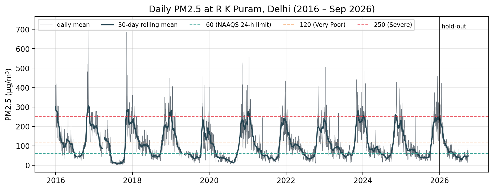
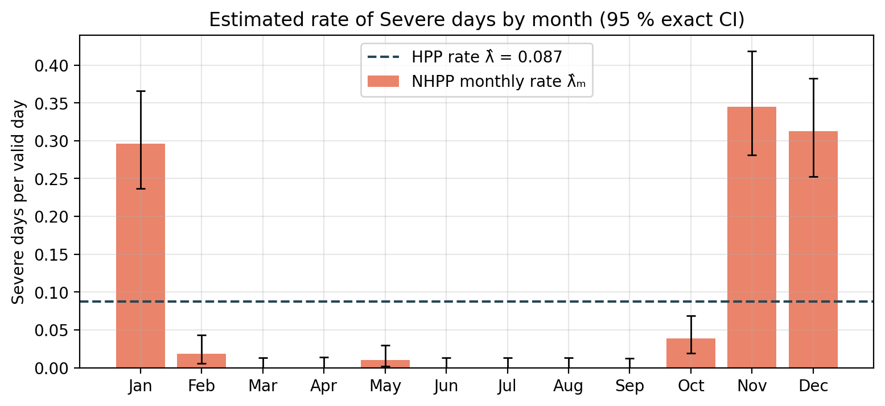
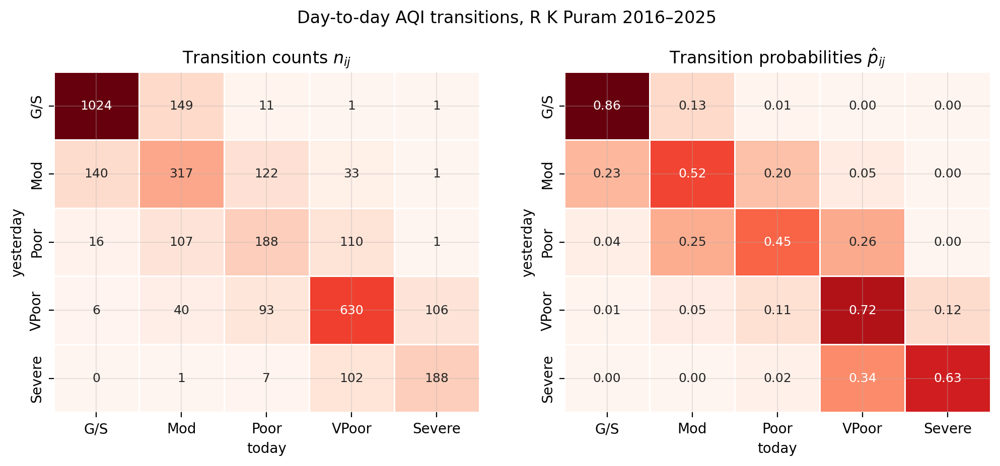
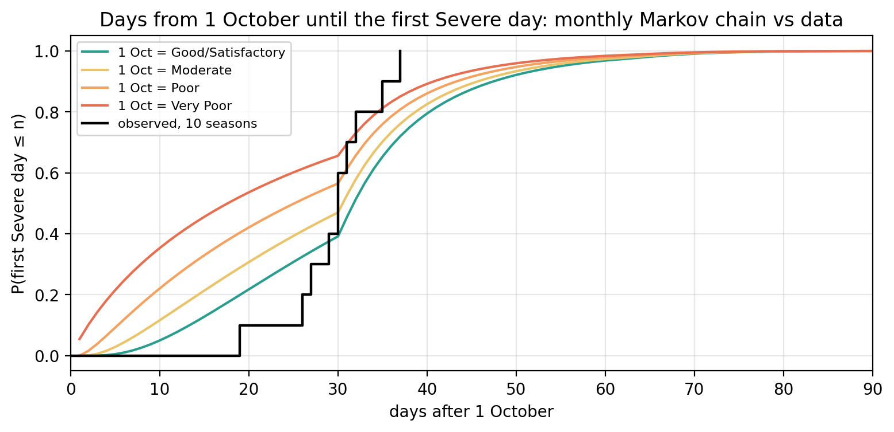
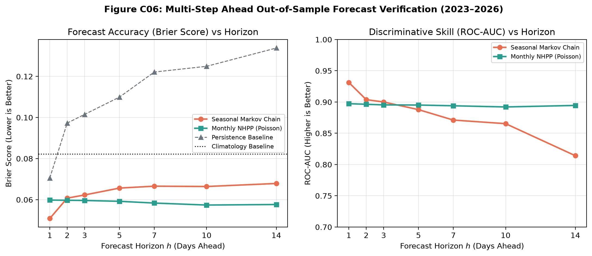

# Stochastic Modelling of Severe Air-Pollution Days in Delhi

## ASM Project Report — 2026M · Group 3

| Name | Roll No. | Role |
|---|---|---|
| Harsh Raj | S20240010084 | Data pipeline and Poisson process |
| Vivian Mathew | S20240010258 | Markov chain |
| Rudraksh Kapil | S20240010204 | Simulation engine and validation |

**Application Domain:** Environmental monitoring — extreme air-pollution events
**Data Source:** Central Pollution Control Board (CPCB), CAAQMS Data Repository — R K Puram, Delhi (DPCC, Site 124)
**Study Period:** 2016–2025 (with 2026 hold-out) · **Code:** github.com/HarshRaj797864/asm-air-pollution (Appendix A)

---

## Abstract

Severe air-quality days in Delhi (daily mean PM2.5 above 250 µg/m³) trigger emergency restrictions, yet their timing is driven by weather, crop burning and festivals that cannot be predicted exactly. Using ten years (2016–2025) of hourly CPCB data from R K Puram, we model Severe days with two stochastic processes. A non-homogeneous Poisson process with monthly rates explains how many Severe days occur: about 32 a year (95% CI 28–36), 94% of them in November–January, with no significant trend, and its intervals covered 95.6% of unseen months in 2023–2026. A five-state seasonal Markov chain on daily AQI bands explains which days and for how long: a Severe day stays Severe with probability 0.63, spells average 2.7 days, one winter day in five is Severe, and the first Severe day arrives about 30 days after 1 October. A shared simulation engine (2,000 replications) shows that the chain reproduces spell lengths and week-long crises (33% of winters vs 36% observed) while the Poisson process does not; out of sample the chain gives the best next-day forecast and the Poisson process the best forecasts beyond one day. Neither model reproduces the month-to-month dispersion of the data, which points to winter-to-winter variation as the main extension.

---

## 1. Introduction and Problem Statement

On a **Severe** air-quality day in Delhi, the 24-hour mean PM2.5 is above 250 µg/m³: the top category of India's National AQI, more than four times the national 24-hour limit of 60 µg/m³, and the level at which emergency measures under the **Graded Response Action Plan (GRAP)** are triggered. Whether a day turns Severe depends on wind, temperature inversions, crop-residue burning, festival fireworks and traffic, none of which can be predicted exactly, so we model Severe days as a **stochastic process**. Two features matter for planning: how many Severe days a winter brings, and how long the bad spells last once they start. A counting process answers the first; a model with day-to-day memory is needed for the second.

> [!IMPORTANT]
> **Research questions:** (1) At what rate do Severe days occur, does the rate depend on the season, and has it changed over 2016–2025? (2) Are Severe days independent events (a Poisson process) or do they cluster? (3) How does air quality move between categories from day to day, and how long do Severe spells last? (4) How well do models fitted on past years predict later years? (5) What could GRAP-style measures change, under assumed effect sizes?

---

## 2. Literature Review

Counts of pollution exceedances are commonly modelled as Poisson processes. Achcar et al. (2008) used a non-homogeneous Poisson process to model the number of ozone peaks above a standard in Mexico City, with a time-varying rate to capture seasonality; our monthly NHPP follows the same idea for PM2.5. Exact (Garwood, 1936) intervals are used for Poisson rates because exceedance counts in some months are small. Checking a point-process model with the time-rescaling theorem (Brown et al., 2002), which turns event times into i.i.d. Exp(1) gaps under a correct intensity, gives a formal goodness-of-fit test beyond counts.

Discrete-state Markov chains are the standard model for day-to-day weather and air-quality states (Guttorp, 1995; Wilks, 2011). Maximum-likelihood estimation of transition probabilities and likelihood-ratio tests of chain order and homogeneity go back to Anderson and Goodman (1957); Katz (1981) compared criteria such as AIC and BIC for choosing the order. Probability forecasts from such models are verified with proper scores such as the Brier score (Brier, 1950) and with ROC curves (Wilks, 2011). For extreme events, Coles (2001) cautions that return levels beyond the length of the record need an extreme-value model, so we report only empirical spell frequencies. Our contribution combines both model families on the same Delhi data, tests each against theory and against unseen years, and uses one simulation engine to compare them on the same features.

---

## 3. Data Description

**Source and cleaning.** Hourly PM2.5 from the CPCB CAAQMS repository ([airquality.cpcb.gov.in/ccr](https://airquality.cpcb.gov.in/ccr/)), R K Puram (site 124), one file per year for 2009–2026. Readings at the analyser cap (1000 µg/m³, 17 hours) were set to missing. A day is *observed* if at least 18 of its 24 hours are valid; gaps of up to 3 days are interpolated (194 days, 5.3%) and longer gaps are left out of the exposure time (223 days, 6.1%). Earlier years are sparse (2014 has no data), so models are fitted on **2016–2025: 3,653 days, 3,430 valid**, every year at least 72% observed. January–September 2026 is kept as an extra hold-out.



PM2.5 has a strong annual cycle: lowest in July–August (monsoon washout), highest in November–January (inversions, crop burning, fireworks). The valid-day mean is 111.9 µg/m³, the median 83.9 and the maximum 729.3 (6 November 2016).

**Event definition.** An *event* is a Severe day (PM2.5 > 250 µg/m³). Lower thresholds are not rare events, so they do not suit a counting process:

| Threshold (µg/m³) | Event days | % of valid days | Episodes | Mean episode length |
|---|---|---|---|---|
| 60 | 2,231 | 65.0% | 185 | 12.1 days |
| 120 | 1,186 | 34.6% | 160 | 7.4 days |
| **250 (Severe)** | **300** | **8.7%** | **112** | **2.7 days** |

The 300 Severe days form 112 episodes (runs of consecutive Severe days); the longest lasted **17 days** from 20 December 2018. For the Markov chain each day is also given its AQI band: Good/Satisfactory 35.0%, Moderate 18.1%, Poor 12.4%, Very Poor 25.8%, Severe 8.7%.

---

## 4. Mathematical Background, Methodology and Implementation

### 4.1 Mathematical Formulation

| Element | Poisson process (Section 5) | Markov chain (Section 6) |
|---|---|---|
| Random variables | $N(t)$ = number of Severe days in $(0, t]$; gaps $X_k$ between Severe days | $X_n$ = AQI band on day $n$ |
| Stochastic process | Counting process: homogeneous (HPP), monthly non-homogeneous (NHPP), compound NHPP | Discrete-time Markov chain, one matrix per season or month |
| State space | $\{0, 1, 2, \ldots\}$ | {Good/Satisfactory, Moderate, Poor, Very Poor, Severe} |
| Time parameter | Continuous $t \ge 0$ in days (observed daily) | Discrete $n = 0, 1, 2, \ldots$ days |
| Assumptions | Independent increments; rate constant (HPP) or constant within a month (NHPP); at most one event per day (law of rare events) | Markov property (tomorrow depends only on today); homogeneous within a season; first order |
| Distributions | $N(t) \sim \text{Poisson}(\Lambda(t))$, $\Lambda(t) = \int_0^t \lambda(s)\,ds$; HPP gaps $X_k \sim \text{Exp}(\lambda)$; compound episode length $L \sim \text{Geometric}(1-q)$ | Spell in state $i$ $\sim \text{Geometric}(1-p_{ii})$; $n$-step law $P^n$; stationary law $\pi$ |

### 4.2 Theoretical Results Used

- **Poisson process.** $E[N(t)] = \text{Var}[N(t)] = \Lambda(t)$, so monthly counts should have dispersion index $\approx 1$. The log-likelihood $n\log\lambda - \lambda T$ is maximised at $\hat{\lambda} = n/T$; the exact interval is $\left[\chi^2_{0.025,2n}/2T,\; \chi^2_{0.975,2n+2}/2T\right]$. The mean gap is $1/\lambda$, and under a correct intensity the rescaled gaps $\Lambda(S_k) - \Lambda(S_{k-1})$ are i.i.d. Exp(1). For the compound model, $E[N] = \Lambda_\mu E[L]$ and $\text{Var}[N] = \Lambda_\mu E[L^2]$.
- **Markov chain.** Maximising $\prod p_{ij}^{n_{ij}}$ subject to $\sum_j p_{ij} = 1$ gives $\hat{p}_{ij} = n_{ij}/n_i$. Chapman–Kolmogorov: $P^{(n)} = P^n$. The stationary distribution solves $\pi = \pi P$, $\sum \pi_j = 1$ (unique for an irreducible aperiodic chain), and $P^n \to \pi$ at a rate set by the second eigenvalue. The mean spell in state $i$ is $1/(1-p_{ii})$, the mean recurrence time of state $j$ is $1/\pi_j$, and mean first-passage times to Severe solve $k_i = 1 + \sum_{j \ne S} p_{ij} k_j$, i.e. $k = (I - Q)^{-1}\mathbf{1}$.

### 4.3 Methodology: Estimation and Validation

1. **Estimation** by maximum likelihood (rates, transition probabilities) with exact or Wilson intervals.
2. **In-sample tests:** Pearson dispersion of monthly counts, KS test of gaps, time-rescaling KS test, likelihood-ratio tests and AIC/BIC between nested models, Anderson–Goodman tests of chain order and seasonal homogeneity, Poisson regression for trend.
3. **Theory vs data:** compare spell means, stationary distribution and first-passage times with their empirical counterparts.
4. **Simulation:** replay each fitted model 2,000 times on the real calendar and compare totals, dispersion, episode lengths and extreme spells with the observed decade.
5. **Out-of-sample:** refit on 2016–2022 and predict 2023–September 2026: interval coverage, log score and absolute error for monthly counts; Brier score and AUC for day-ahead and multi-day forecasts.

### 4.4 Computational Implementation

All code is our own Python (NumPy, pandas, SciPy, statsmodels, Matplotlib) in four Jupyter notebooks that run top to bottom with a fixed random seed (Appendix A): `01` data cleaning and exploratory analysis, `02` Poisson models, `03` Markov chain, `04` simulation engine and validation. Fitted parameters are passed between notebooks as JSON files in `results/`, and every figure in this report is saved by the notebooks in `figures/`.

---

## 5. Real Data Results I — Poisson Process (Harsh Raj)

### 5.1 Estimation

With $n = 300$ Severe days in $T = 3{,}430$ valid days, the HPP estimate and its exact interval are

$$\hat{\lambda} = 0.0875 \text{ per day} \;(0.078\text{–}0.098) \;\approx\; 31.9 \text{ Severe days per year} \;(28.4\text{–}35.8)$$

### 5.2 The HPP is Rejected

Monthly counts have mean 2.5 and variance 21.4: a Pearson dispersion index of **8.1** where a Poisson process needs about 1 ($\chi^2 = 965$, df = 119). **66% of gaps between Severe days are a single day**, against 9% expected under the HPP (KS $D = 0.58$, $p \approx 10^{-93}$).


### 5.3 Seasonality is the Main Effect



November (0.345 per day), December (0.312) and January (0.296) hold **94% of Severe days (281 of 300)**, about one day in three; March–September had three Severe days in ten years.

| Model | Parameters | Log-likelihood | AIC | Dispersion |
|---|---|---|---|---|
| HPP | 1 | −462.8 | 927.6 | 8.11 |
| Seasonal NHPP | 4 | −217.7 | 443.3 | 3.45 |
| **Monthly NHPP** | **12** | **−122.9** | **269.8** | **1.77** |

The likelihood-ratio test of the HPP against the monthly NHPP gives LR = 680 (df 11, $p < 10^{-30}$). A Poisson regression with month and year effects finds **no trend**: −0.4% per year (95% CI −5.6% to +5.0%; quasi-Poisson $\hat{\phi} = 1.54$, year effect $p = 0.10$).

### 5.4 Clustering Remains

**63% of Severe days (188 of 300) follow another Severe day.** Episode *onsets* behave like a Poisson process (dispersion 0.89, $p = 0.71$), and episode lengths are roughly geometric with $\hat{q} = 0.627$ (chi-square $p = 0.018$). The time-rescaling theorem confirms this: rescaled gaps should be i.i.d. Exp(1), and the KS distance falls from 0.51 (HPP) to 0.23 (NHPP, $p \approx 10^{-14}$) for Severe days, and to 0.17 ($p = 0.004$) for episode onsets. Seasonality is fixed by the NHPP; clustering is not, which motivates the Markov chain.

### 5.5 Out-of-Sample Test (Fitted on 2016–2022)

| Year | Observed | HPP 95% PI | Monthly NHPP 95% PI | Compound 95% PI |
|---|---|---|---|---|
| 2023 | 44 | 18–39 ✗ | 19–40 ✗ | 9–51 ✓ |
| 2024 | 34 | 19–39 ✓ | 18–40 ✓ | 10–53 ✓ |
| 2025 | 35 | 19–39 ✓ | 18–39 ✓ | 9–54 ✓ |
| 2026 (Jan–Sep) | 7 | 13–31 ✗ | 5–17 ✓ | 0–25 ✓ |

Over 45 test months the monthly NHPP has the best log score (−0.99; HPP −3.36, compound −1.05), the lowest mean absolute error (1.09) and 95.6% interval coverage. Its only miss is the bad winter of 2023.

---

## 6. Real Data Results II — Markov Chain (Vivian Mathew)

### 6.1 Estimated Transition Matrix



From 3,394 transitions the diagonal dominates (Good/Satisfactory 0.86, Moderate 0.52, Poor 0.45, Very Poor 0.72, Severe 0.63), and only 3.5% of days move two or more bands. Severe is entered almost only from Very Poor (0.12) and left almost only to Very Poor (0.34).

> [!NOTE]
> **Consistency check:** $\hat{p}_{SS} = 188/298 = 0.631$ (95% CI 0.575–0.684), close to the Poisson episode estimate $\hat{q} = 188/300 = 0.627$. They agree because both count the same 188 Severe-to-Severe days, so this confirms the two analyses are consistent; it is not independent evidence. The implied mean spell $1/(1-0.631) = 2.71$ days matches the observed 2.68.

### 6.2 Seasons and Memory

Transition matrices differ between seasons ($G^2 = 347$, df = 54, $p \approx 10^{-44}$; winter vs summer $p \approx 10^{-20}$), so a matrix is fitted per season. In winter, Very Poor → Severe is 0.14 against 0.01 in summer: seasons change how easily the chain **enters** Severe, not how long it **stays**. Starting from a Severe winter day, $P^n$ gives:

| Days ahead | 1 | 2 | 3 | 7 | 14 | 30 |
|---|---|---|---|---|---|---|
| $P(\text{Severe})$ | 0.63 | 0.44 | 0.34 | 0.23 | 0.21 | 0.21 |

Memory fades within about a week (second eigenvalue 0.70 in winter). The winter stationary distribution gives $\pi_{\text{Severe}} = 0.206$ against 0.214 observed: **one winter day in five is Severe**. All-year, $1/\pi_5 = 11.5$ days, essentially the same quantity as the Poisson mean gap $1/\hat{\lambda} = 11.4$. Geometric spell means match the observed means for all five states (Severe 2.7 vs 2.7).

**Order of the chain.** Within winter, a second-order chain adds nothing (Anderson–Goodman $G^2 = 39.8$, df = 45, $p = 0.69$; post-monsoon $p = 0.09$), and BIC picks order 1; the pooled test rejects order 1 only because it mixes seasons. Two Severe days in a row do not make a third more likely (0.65 vs 0.61, Fisher $p = 0.53$).

### 6.3 When the Smog Season Starts



Using monthly matrices from 1 October with Severe made absorbing, the chain predicts the first Severe day after about **29 days** from a Moderate start (the usual 1 October state). In the 10 observed seasons it came after 19–37 days (**mean 29.6**), and all 10 seasons had one by 15 November (model: 87–93%). Real start dates are more tightly bunched than predicted, because one October matrix spreads the late-October Diwali and crop-burning spike over the whole month.

### 6.4 Next-Day Forecasts (Fitted on 2016–2022, Tested on 2023–Sep 2026)

| Model | Mean log score | Accuracy | Brier $P(\text{Severe})$ |
|---|---|---|---|
| Monthly category frequencies | −1.042 | 0.551 | 0.0598 |
| Order 1, all-year | −0.903 | 0.647 | 0.0521 |
| **Order 1, seasonal** | **−0.853** | **0.646** | **0.0508** |
| Order 2, seasonal | −0.898 | 0.630 | 0.0509 |
| Monthly NHPP (Section 5) | — | — | 0.0598 |

The seasonal first-order chain gives the best next-day forecasts because it uses today's state.

---

## 7. Simulation Results and Model Validation (Rudraksh Kapil)

### 7.1 Simulation Engine & Parameter Recovery

Rudraksh Kapil combined both models in one Python simulation engine (`StochasticAirQualitySimulator`, notebook 04). It simulates the HPP, monthly and compound NHPPs, and all-year, seasonal and monthly Markov chains on the real 3,653-day calendar with its missing-day mask. Markov paths are advanced for all replications at once by inverse-CDF sampling: take each path's row of today's matrix, form its cumulative sum, and pick the first state whose cumulative probability exceeds a uniform draw.

Monte Carlo parameter recovery (500 replicates per size, true $p_{SS} = 0.625$, $N$ = 200 to 10,000) confirms the estimator behaves as theory predicts: the bias vanishes (mean estimate 0.614 at $N = 200$, 0.625 at $N = 10{,}000$), the standard deviation falls roughly as $N^{-1/2}$ (0.079 → 0.010), and 95% interval coverage stays between 93.2% and 96.6%, within Monte Carlo error of the nominal level.


### 7.2 Comparative Simulation: Monthly Dispersion

Each model was replayed **2,000 times** on the 2016–2025 calendar. All reproduce the ten-year total of about 300 Severe days, but they differ sharply in month-to-month variation, measured by the dispersion index $D = \frac{1}{M-k}\sum_m (n_m - \mu_m)^2/\mu_m$ (observed $D_{\text{obs}} = 1.77$):

| Model | Simulated total (95% range) | Monthly $D$ (mean, 95% range) | $P(D_{\text{sim}} \ge 1.77)$ | Verdict |
|---|---|---|---|---|
| HPP | 300 (267–336) | 10.6 (7.2–15.2) | 1.000 | Ignores seasonality |
| Monthly NHPP | 301 (269–334) | 1.1 (0.7–1.7) | 0.015 | Too regular: no clustering |
| Compound NHPP | 300 (231–379) | 8.2 (3.0–18.9) | 1.000 | Far too variable |
| Seasonal Markov chain | 287 (228–345) | 20.3 (9.9–35.1) | 1.000 | Far too variable |
| Monthly Markov chain | 299 (245–354) | 6.8 (2.4–15.8) | 0.996 | Too variable |

**No model reproduces the observed dispersion.** The NHPP assumes independent days, so its monthly counts are too steady. A first-order chain has lag-$k$ autocorrelation $\rho^k$ with $\rho = p_{SS} - p_{\bar{S}S} \approx 0.53$ in winter, which inflates monthly variance by roughly $(1+\rho)/(1-\rho) \approx 3.2$: whole spells pile into single months. Real Severe days cluster within spells, but the spells are spread more evenly across a winter than a simple chain expects, which points to winter-to-winter variation in the intensity itself (a Cox process or hidden regimes).


### 7.3 Episode Lengths & Extreme Spells

Markov-simulated episode lengths match the 112 real episodes: mean 2.64 days against 2.68, and a two-sample KS test cannot tell them apart ($D = 0.089$, $p = 0.32$). The compound NHPP's episode lengths are not compared, because in the current code all of an episode's days are placed on its onset day.

For the longest Severe run of each December–February winter (11 real winters; 20,000 simulated winters per model, the chain started from its winter stationary distribution):

| Longest Dec–Feb run | Real winters (n = 11) | Winter Markov chain | Monthly NHPP |
|---|---|---|---|
| Mean | 6.3 days | 5.9 days | 3.2 days |
| $P(\ge 7 \text{ days})$ | 36% (4 of 11) | 33% | 1.0% |
| $P(\ge 10 \text{ days})$ | 9% (1 of 11) | 8.6% | 0.04% |

Without memory, a week-long Severe crisis happens in about 1% of winters; the Markov chain gives 33%, close to the observed 4 of 11. The chain still makes the 17-day record (from 20 December 2018) a roughly 1-in-400-winter event, so the real tail is heavier than either model. With only 11 winters we do not estimate return levels beyond the length of the record.


### 7.4 Multi-Step Forecast Verification (2023–Sep 2026)

Both models were refitted on 2016–2022 and scored on every day of 2023–September 2026 (about 1,300 forecasts per horizon). The Markov forecast uses Chapman–Kolmogorov, $P(X_{t+h} = \text{Severe} \mid X_t = i) = [P_{\text{season}}^h]_{i,\text{Severe}}$; the NHPP forecast is the target month's rate.

| Horizon $h$ | Brier (Markov) | Brier (NHPP) | Skill vs climatology (Markov / NHPP) | AUC (Markov) | AUC (NHPP) |
|---|---|---|---|---|---|
| 1 day | **0.051** | 0.060 | **38%** / 27% | **0.931** | 0.897 |
| 3 days | 0.062 | **0.060** | 24% / **27%** | **0.900** | 0.895 |
| 7 days | 0.067 | **0.058** | 16% / **27%** | 0.871 | **0.894** |
| 14 days | 0.068 | **0.058** | 14% / **27%** | 0.814 | **0.895** |

The Markov chain has the lower Brier score **only one day ahead** (from two days on the NHPP is better) and ranks days better (higher AUC) up to three days ahead. Because $P^h \to \pi$ within about a week, the chain forgets today's state, while the NHPP keeps finer monthly detail. Both beat climatology at every horizon.



### 7.5 GRAP Policy Scenarios (Assumed Effects)

3,000 independent 90-day winters were simulated with the winter matrix under modified transition probabilities. **The effect sizes are assumptions chosen to show the mechanism, not estimates of what GRAP achieves.**

| Scenario | Severe days (mean) | Change | 5-day crises per winter | $P(\ge 1 \text{ crisis})$ |
|---|---|---|---|---|
| Baseline | 18.4 | — | 1.02 | 66.3% |
| Entry curb (−20% Very Poor → Severe) | 15.5 | −16% | 0.85 (−17%) | 58.8% |
| Persistence curb (−15% Severe → Severe) | 15.4 | −16% | 0.56 (−45%) | 44.3% |
| Combined | 12.9 | −30% | 0.46 (−55%) | 37.7% |


> [!IMPORTANT]
> **Mechanism, not forecast:** for a similar cut in total Severe days, reducing persistence removes about 45% of 5-day crises, about 2.6 times the effect of the entry curb, because persistence multiplies into every extra day of a spell. Combined, the assumed measures cut Severe days by 30% and the chance of a 5-day crisis from 66% to 38%. Real effect sizes would have to be estimated, for example from GRAP activation dates.

---

## 8. Discussion: Theory, Data and Interpretation

### 8.1 Cross-Model Consistency

| Quantity | Poisson (Harsh Raj) | Markov (Vivian Mathew) | Simulation (Rudraksh Kapil) |
|---|---|---|---|
| $P(\text{Severe} \mid \text{Severe})$ | $\hat{q} = 188/300 = 0.627$ | $\hat{p}_{SS} = 188/298 = 0.631$ | Recovered without bias (7.1) |
| Mean Severe spell | 2.68 days | 2.71 days | 2.64 days (simulated) |
| Mean recurrence time | $1/\hat{\lambda} = 11.4$ days | $1/\pi_5 = 11.5$ days | — |
| Annual Severe days | 31.9 per year | $365\,\pi_5 = 31.7$ | 300.7 per 10 years (NHPP) |

The Poisson and Markov columns agree because they are computed from the same 300 Severe days, so they confirm the analyses are consistent rather than giving independent evidence. The genuinely independent checks are the theoretical predictions tested against data below.

### 8.2 Where Theory Matches and Where It Diverges

| Theoretical prediction | Empirical result | Status |
|---|---|---|
| Geometric spells, $E[D] = 1/(1-p_{ii})$ | Matches observed means for all 5 states | ✓ |
| Stationary distribution $\pi = \pi P$ | Within 1% of observed frequencies | ✓ |
| $P^n \to \pi$ (winter eigenvalue 0.70) | Memory gone within a week; explains the forecast crossover | ✓ |
| NHPP 95% monthly intervals | 95.6% coverage on 45 unseen months | ✓ |
| First-order chain within seasons | Anderson–Goodman $p = 0.69$ (winter) | ✓ |
| First Severe day about 29 days after 1 October | Observed mean 29.6 days | ✓ |
| MLE standard error $\propto N^{-1/2}$ | Confirmed by parameter recovery | ✓ |
| Markov episode lengths | KS $p = 0.32$ against real episodes | ✓ |
| Monthly dispersion (NHPP 1.1, Markov 6.8) | $D_{\text{obs}} = 1.77$ | ✗ neither model |
| Geometric spell shape, $P(L \ge 3) = 0.39$ | Observed 0.30 (chi-square $p = 0.018$); record 17 days | ✗ shape and extreme tail |
| NHPP 2023 interval 19–40 | Observed 44 (and 16 in 2022) | ✗ year-to-year variation |

The remaining dispersion, the extreme tail and the year-to-year swings all point to winter-to-winter meteorological variation and latent regimes that stationary models do not capture.

### 8.3 Model Selection Guide

| Decision question | Best model | Rationale |
|---|---|---|
| Severe days per month or winter | Monthly NHPP | 95.6% coverage, best log score, MAE 1.09 |
| Will tomorrow be Severe? | Seasonal Markov chain | Brier 0.051 vs 0.060 |
| Severe in 2 or more days? | Monthly NHPP | Lower Brier score from $h = 2$ |
| Spell length, chance of a week-long crisis | Markov chain | Episode KS $p = 0.32$; 33% vs 36% observed |
| Which policy lever matters most | Markov simulation | Direct control of entry and persistence (assumed effects) |

### 8.4 Interpretation for Delhi

1. **Severe air is a predictable seasonal crisis.** 94% of Severe days fall in November–January (low mixing heights, calm winds, post-harvest burning); the first typically arrives around 1 November, so October is the window to prepare. There is no detectable improvement over 2016–2025.
2. **Severe days come in runs.** With persistence 0.63, spells average 2.7 days, one winter day in five is Severe and about one winter in three has a run of a week or more, with cumulative health costs beyond isolated bad days.
3. **Different decisions need different models:** seasonal counts for planning from the NHPP, next-day warnings from the Markov chain, and (under assumed effects) the insight that ending spells faster matters most for the worst episodes.

---

## 9. Limitations and Possible Extensions

**Limitations.** One station at daily resolution; 6.1% of days missing and 5.3% interpolated (interpolation can create or remove threshold crossings); only 11 winters for extremes. No weather or fire covariates, so the models describe patterns, not causes. Matrices are constant within a season or month, which blurs the sharp October–November transition. Neither model captures year-to-year variation or the monthly dispersion. Categories ignore how far PM2.5 is within a band. The policy effects are assumed. In notebook 04 the compound simulator places an episode's days on its onset day, which invalidates that model's episode-length comparison only.

**Extensions.** A Cox (doubly stochastic) process or hidden Markov model with clean and smoggy regimes, for year-to-year variation; transition probabilities driven by wind, mixing height and fire counts (multinomial-logistic Markov chain); a Hawkes process for self-exciting clustering; weekly-varying matrices for October–November; several stations across Delhi NCR; and policy effects estimated from real GRAP activation dates.

---

## 10. Conclusion

Severe air-pollution days in Delhi are well described by two complementary stochastic models. A monthly non-homogeneous Poisson process captures how many Severe days occur: about 32 a year, concentrated in November–January, with no detectable improvement over 2016–2025 and well-calibrated predictions for unseen years. A seasonal first-order Markov chain captures persistence: a Severe day stays Severe with probability 0.63, so spells average 2.7 days and week-long crises occur in about a third of winters, which the memoryless Poisson model cannot produce. Theory and data agree on spell lengths, the stationary distribution and the timing of the season's first Severe day; they disagree on month-to-month dispersion and the most extreme spells, which call for models with winter-to-winter variation and weather covariates.

---

## References

1. Anderson, T. W., Goodman, L. A. (1957), "Statistical inference about Markov chains", *Annals of Mathematical Statistics* 28(1), 89–110.
2. Achcar, J. A., Fernández-Bremauntz, A. A., Rodrigues, E. R., Tzintzun, G. (2008), "Estimating the number of ozone peaks in Mexico City using a non-homogeneous Poisson model", *Environmetrics* 19(5), 469–485.
3. Brier, G. W. (1950), "Verification of forecasts expressed in terms of probability", *Monthly Weather Review* 78(1), 1–3.
4. Brown, E. N., Barbieri, R., Ventura, V., Kass, R. E., Frank, L. M. (2002), "The time-rescaling theorem and its application to neural spike train data analysis", *Neural Computation* 14(2), 325–346.
5. Central Pollution Control Board (2014), *National Air Quality Index*; CPCB CCR, *CAAQMS Data Repository*, https://airquality.cpcb.gov.in/ccr/ (accessed Oct 2026).
6. Commission for Air Quality Management in NCR (2022), *Graded Response Action Plan (GRAP) for NCR*, Government of India.
7. Garwood, F. (1936), "Fiducial limits for the Poisson distribution", *Biometrika* 28, 437–442.
8. Guttorp, P. (1995), *Stochastic Modeling of Scientific Data*, Chapman & Hall/CRC.
9. Coles, S. (2001), *An Introduction to Statistical Modeling of Extreme Values*, Springer.
10. Katz, R. W. (1981), "On some criteria for estimating the order of a Markov chain", *Technometrics* 23(3), 243–249.
11. Ross, S. M., *Introduction to Probability Models*, Academic Press.
12. Wilks, D. S. (2011), *Statistical Methods in the Atmospheric Sciences*, Academic Press.
13. World Health Organization (2021), *WHO Global Air Quality Guidelines*, Geneva.

---

## Individual Contributions

| Member | Contribution |
|---|---|
| **Harsh Raj** | CPCB data download and cleaning; shared daily dataset; exploratory analysis and threshold choice; homogeneous, monthly and compound Poisson models with likelihood-ratio, time-rescaling and out-of-sample tests (notebooks 01–02) |
| **Vivian Mathew** | Five-state Markov chain with all-year, seasonal and monthly matrices; $n$-step, stationary, spell-length and first-passage results including the season-start model; homogeneity and order tests; next-day validation (notebook 03) |
| **Rudraksh Kapil** | Shared simulation engine; parameter recovery; dispersion and episode comparisons; extreme spells; multi-day forecast verification; policy scenarios (notebook 04) |

<div style="break-before: page"></div>

## Appendix A — Code

All code is in the public repository **github.com/HarshRaj797864/asm-air-pollution** and in the submitted zip folder. Install the packages in `requirements.txt`, then run the notebooks in order from the `notebooks/` folder; each runs in under a minute with a fixed seed.

| Notebook | Contents | Outputs |
|---|---|---|
| `01_data_cleaning_eda.ipynb` | Reads 18 hourly CPCB files; cleaning, daily means, gap interpolation, AQI bands; exploratory plots | `data/clean/delhi_rkpuram_daily.csv`, figures A01–A05 |
| `02_poisson_model.ipynb` | HPP, monthly and compound NHPP: MLE, exact CIs, dispersion, LR/AIC, trend, time-rescaling, simulation, out-of-sample test | `results/A02_*.json`, `poisson_params.json`, figures A06–A15 |
| `03_markov_chain.ipynb` | Transition matrices (all-year, seasonal, monthly), $n$-step and stationary laws, spells, first passage, order tests, next-day validation | `results/B01_*.json`, `markov_params.json`, figures B01–B07 |
| `04_simulation_validation.ipynb` | Shared simulation engine, parameter recovery, dispersion and episode comparisons, extreme spells, multi-day forecasts, policy scenarios | `results/C01_*.json`, `C02_*.json`, figures C01–C08 |

Key functions, copied from the notebooks:

**Exact Poisson rate interval (notebook 02)**

```python
def rate_ci(n, T, alpha=0.05):
    """MLE of a Poisson rate and its exact (Garwood) confidence interval."""
    lo = 0.0 if n == 0 else stats.chi2.ppf(alpha / 2, 2 * n) / 2
    hi = stats.chi2.ppf(1 - alpha / 2, 2 * n + 2) / 2
    return n / T, lo / T, hi / T
```

**Pearson dispersion index (notebook 02)**

```python
def pearson_dispersion(n, mu, n_params):
    """Pearson X^2 / df. Equals about 1 if counts are Poisson with means mu.
    Cells with a fitted mean of 0 (months whose estimated rate is 0) carry no information,
    so they are dropped; n_params counts only the non-zero rate parameters."""
    n, mu = np.asarray(n, float), np.asarray(mu, float)
    keep = mu > 0
    x2 = float(np.sum((n[keep] - mu[keep]) ** 2 / mu[keep]))
    dof = int(keep.sum()) - n_params
    return x2 / dof, x2, dof, float(stats.chi2.sf(x2, dof))
```

**First-passage distribution with monthly matrices (notebook 03)**

```python
def first_passage_cdf(start_state, dates, P_by_month, target=SEV):
    """P(first visit to `target` is on or before each date), starting the day before dates[0]."""
    v = np.zeros(K)
    v[start_state] = 1.0
    cdf = []
    for d in dates:
        v = v @ P_by_month[d.month]
        v[target] = 0.0                                  # absorbed mass = already hit
        cdf.append(1 - v.sum())
    return np.array(cdf)
```

**Vectorised Markov simulation (notebook 04, StochasticAirQualitySimulator)**

```python
def simulate_markov(self, seasons_or_months, n_sim=2000, model_type="seasonal", init_state=0):
    """Vectorized Monte Carlo simulation of Markov trajectories."""
    n_days = len(seasons_or_months)
    states = np.zeros((n_sim, n_days), dtype=int)
    states[:, 0] = init_state
    
    for t in range(1, n_days):
        key = seasons_or_months[t]
        P_curr = self.P_season[key] if model_type == "seasonal" else self.P_month[key]
        prev = states[:, t-1]
        probs = P_curr[prev]
        cdf = np.cumsum(probs, axis=1)
        cdf[:, -1] = 1.0
        r = self.rng.random((n_sim, 1))
        states[:, t] = np.clip((r > cdf).sum(axis=1), 0, K - 1)
    return states
```
