# Stochastic Modelling of Severe Air-Pollution Days in Delhi

## ASM Project Report — 2026M

**Team:** Harsh Raj (data and Poisson process) · Vivian Mathew (Markov chain) · Rudraksh Kapil (simulation and validation)
**Application Domain:** Environmental Science / Urban Air Quality Management
**Data Source:** Central Pollution Control Board (CPCB), CAAQMS Data Repository — R K Puram, Delhi (DPCC, Site 124)
**Study Period:** 2016–2025 (with 2026 hold-out)

---

## Table of Contents

1. [Problem Statement](#1-problem-statement)
2. [Data Description & Exploratory Analysis](#2-data-description--exploratory-analysis)
3. [Model I — Poisson Process (Harsh Raj)](#3-model-i--poisson-process-harsh-raj)
4. [Model II — Markov Chain (Vivian Mathew)](#4-model-ii--markov-chain-vivian)
5. [Model III — Simulation Engine & Validation (Rudraksh Kapil)](#5-model-iii--simulation-engine--validation-rudraksh-kapil)
6. [Comparison of Theoretical and Empirical Results](#6-comparison-of-theoretical-and-empirical-results)
7. [Interpretation in the Context of Application](#7-interpretation-in-the-context-of-application)
8. [Limitations](#8-limitations)
9. [Possible Extensions](#9-possible-extensions)
10. [References](#10-references)

---

## 1. Problem Statement

Delhi has some of the worst urban air quality in the world. On a **Severe** air-quality day (24-hour mean PM2.5 above 250 µg/m³ — the top category of India's National AQI), the air is harmful even to healthy people, schools are often closed, and emergency measures under the **Graded Response Action Plan (GRAP)** are triggered.

Whether a given day becomes Severe depends on many factors that cannot be predicted exactly: wind speed, temperature inversions, crop-residue burning in neighbouring states, festival fireworks, traffic, and dust. The number and timing of Severe days is therefore naturally modelled as a **random (stochastic) process**.

> [!IMPORTANT]
> **Central Research Questions:**
> 1. At what rate do Severe days occur, and how uncertain is that rate?
> 2. Does the rate depend on the season, and has it changed between 2016 and 2025?
> 3. Are Severe days independent random events (a Poisson process), or do they come in clusters?
> 4. How does air quality move between categories from one day to the next?
> 5. How well do models fitted on past years predict Severe days in later years?
> 6. What could GRAP-style interventions change, under assumed effect sizes?

---

## 2. Data Description & Exploratory Analysis

### 2.1 Data Source and Cleaning

**Source:** CPCB Central Control Room for Air Quality Management, CAAQMS Data Repository ([airquality.cpcb.gov.in/ccr](https://airquality.cpcb.gov.in/ccr/)). Station: **R K Puram, Delhi – DPCC** (site 124), a residential area in south Delhi. Hourly concentrations of pollutants and weather variables, one file per year, 2009–2026 (downloaded October 2026). We use **PM2.5 (µg/m³)**.

| Step | Rule | Effect |
|---|---|---|
| Implausible values | Readings at the analyser cap (1000 µg/m³) set to missing | 17 hours, all in 2011 |
| Daily mean | Day is *observed* if ≥ 18 of 24 hours are valid (75% rule) | — |
| Short gaps | Gaps of ≤ 3 consecutive days linearly interpolated | 194 days (5.3%) |
| Long gaps | Left missing, excluded from exposure time | 223 days (6.1%) |

### 2.2 Data Coverage

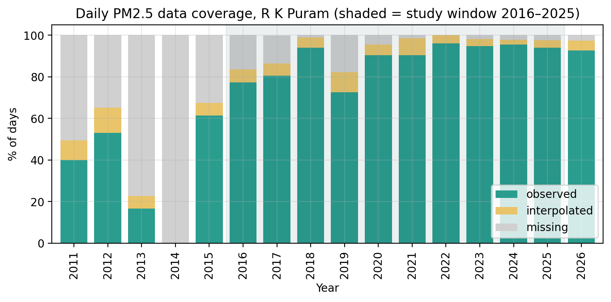

**Study window:** 2009–2010 have no data, 2014 has none, 2013 has only 17%. From **2016 to 2025** every year has at least 72% observed days (2018 and 2020–2025 ≥ 90%), so the models are estimated on these **10 years (3,653 days, 3,430 valid)**. January–September 2026 is kept as an additional hold-out period.

### 2.3 Summary Statistics (2016–2025, Valid Days)

| Statistic | Value |
|---|---|
| Mean PM2.5 | 111.9 µg/m³ |
| Median PM2.5 | 83.9 µg/m³ |
| Maximum PM2.5 | 729.3 µg/m³ (6 November 2016) |
| Total valid days | 3,430 |

### 2.4 AQI Category Distribution

| AQI Category | Days | % of Days |
|---|---|---|
| Good (≤ 30) | 397 | 11.6% |
| Satisfactory (30–60) | 802 | 23.4% |
| Moderate (60–90) | 620 | 18.1% |
| Poor (90–120) | 425 | 12.4% |
| Very Poor (120–250) | 886 | 25.8% |
| **Severe (> 250)** | **300** | **8.7%** |

### 2.5 Temporal Patterns

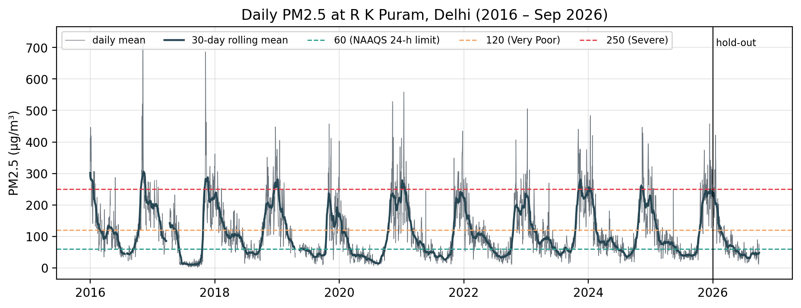

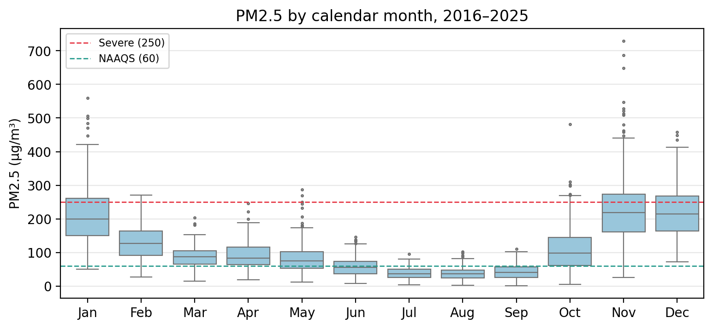

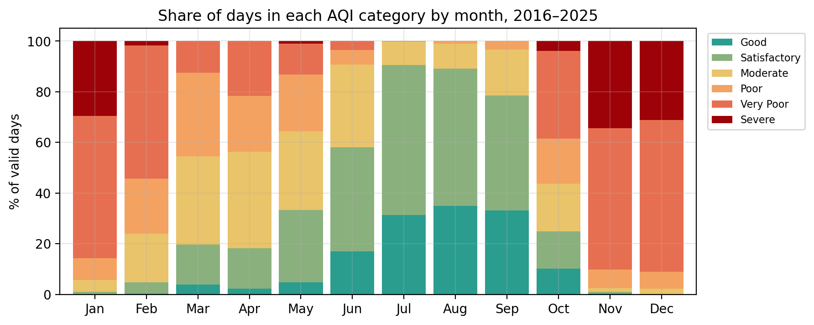

Pollution has a very strong annual cycle: monthly medians are lowest in July–August (monsoon washout) and highest in November–January (winter inversions, crop burning and festival fireworks).

### 2.6 Event Definition

We define an *event* as a day with PM2.5 > 250 µg/m³ ("Severe"). In 10 years: **300 Severe days** forming **112 episodes** (runs of consecutive Severe days) with a mean length of **2.7 days** and a maximum of **17 days** (from 20 December 2018).

| Threshold (µg/m³) | Event Days | % of Valid Days | Episodes | Mean Episode Length |
|---|---|---|---|---|
| 60 | 2,231 | 65.0% | 185 | 12.1 days |
| 90 | 1,611 | 47.0% | 186 | 8.7 days |
| 120 | 1,186 | 34.6% | 160 | 7.4 days |
| **250** | **300** | **8.7%** | **112** | **2.7 days** |

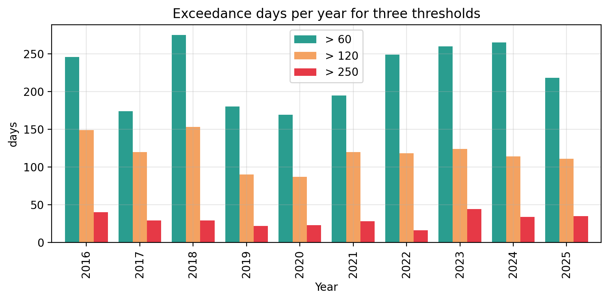

---

## 3. Model I — Poisson Process (Harsh Raj)

### 3.1 Theoretical Formulation

Let time $t$ be measured in days. The counting process $N(t)$ is the number of Severe days in $(0, t]$, with state space $\{0, 1, 2, \ldots\}$.

**Homogeneous Poisson Process (HPP)** with rate $\lambda$:
- $N(0) = 0$, independent and stationary increments
- $N(t) \sim \text{Poisson}(\lambda t)$
- $E[N(t)] = \text{Var}[N(t)] = \lambda t$
- Inter-arrival times: $X_k \sim \text{Exp}(\lambda)$ i.i.d.

**Non-Homogeneous Poisson Process (NHPP)** with piecewise-constant monthly rate $\lambda(t) = \lambda_{m(t)}$:
$$N(t) \sim \text{Poisson}(\Lambda(t)), \quad \Lambda(t) = \int_0^t \lambda(s)\,ds$$

**Compound (Clustered) NHPP**: Episode onsets arrive as an NHPP with rate $\mu_{m(t)}$; each episode lasts $L_i \sim \text{Geometric}(1-q)$ days:
$$N(t) = \sum_{i=1}^{K(t)} L_i, \quad E[N] = \Lambda_\mu E[L], \quad \text{Var}[N] = \Lambda_\mu E[L^2]$$

Because data are daily, at most one event is observed per day; with small daily rates a Bernoulli day process is well approximated by a Poisson process (law of rare events). This approximation is weaker in winter, where the rate is about 0.3 per day.

### 3.2 Parameter Estimation

The MLE is $\hat{\lambda} = n/T$, with an exact 95% CI from the Garwood chi-square relation:

$$\left[\frac{\chi^2_{0.025, 2n}}{2T},\; \frac{\chi^2_{0.975, 2n+2}}{2T}\right]$$

**HPP Results:** $n = 300$, $T = 3{,}430$ days →

$$\hat{\lambda} = 0.0875 \text{ per day} \;\; (95\% \text{ CI: } 0.078\text{–}0.098) \;\approx\; 31.9 \text{ Severe days/year} \;\; (28.4\text{–}35.8)$$

### 3.3 Monthly NHPP Rates

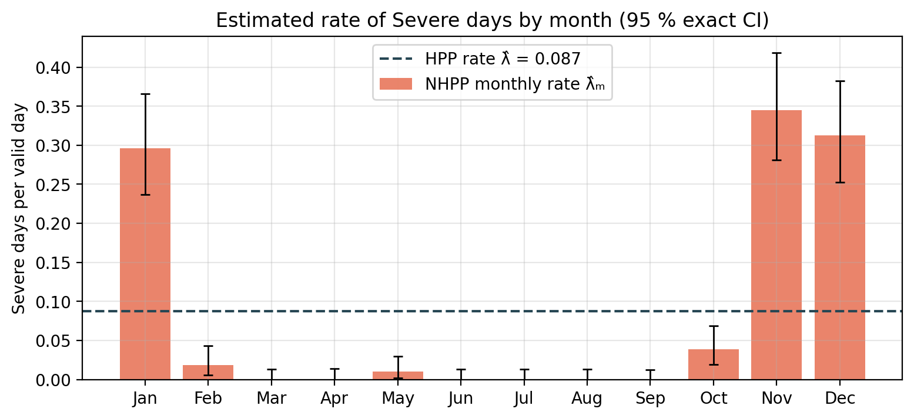

| Month | Severe Days | $\hat{\lambda}_m$ per day | 95% CI |
|---|---|---|---|
| **November** | 102 | **0.345** | 0.281–0.418 |
| **December** | 94 | **0.312** | 0.252–0.382 |
| **January** | 85 | **0.296** | 0.237–0.366 |
| October | 11 | 0.038 | 0.019–0.069 |
| February | 5 | 0.018 | 0.006–0.043 |
| May | 3 | 0.010 | 0.002–0.030 |
| Mar, Apr, Jun–Sep | 0 | 0.000 | — |

**94% of Severe days (281 of 300) fall in November–January**, where approximately one day in three is Severe.

### 3.4 Model Checking — HPP is Rejected

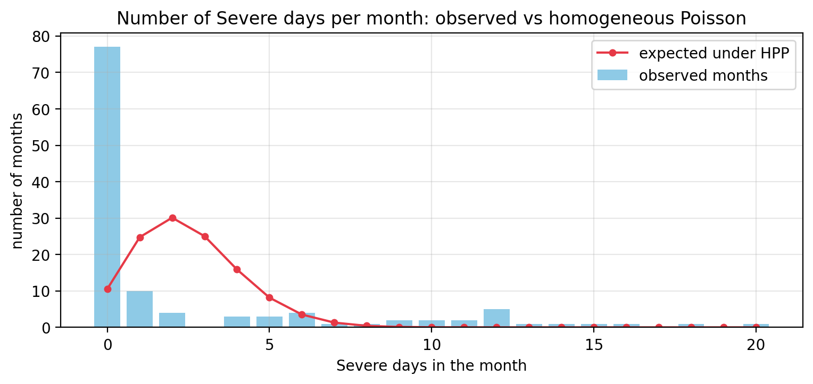

- **Dispersion:** Monthly counts have mean 2.5 and variance 21.4; Pearson dispersion index = **8.1** (should be ≈ 1 under the HPP; $\chi^2 = 965$, df = 119, $p < 10^{-100}$)
- **Inter-arrival times:** 66% of gaps are exactly 1 day (vs 9% expected under the HPP); KS test vs $\text{Exp}(\hat{\lambda})$: $D = 0.58$, $p \approx 10^{-93}$

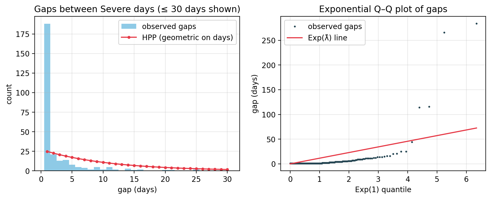

### 3.5 Seasonality is the Main Effect

| Model | Parameters | Log-likelihood | AIC | Dispersion |
|---|---|---|---|---|
| HPP | 1 | −462.8 | 927.6 | 8.11 |
| Seasonal NHPP | 4 | −217.7 | 443.3 | 3.45 |
| **Monthly NHPP** | **12** | **−122.9** | **269.8** | **1.77** |

Likelihood-ratio test of the HPP against the monthly NHPP: LR = 680 (df 11, $p < 10^{-30}$). The monthly NHPP follows the observed staircase of cumulative counts:

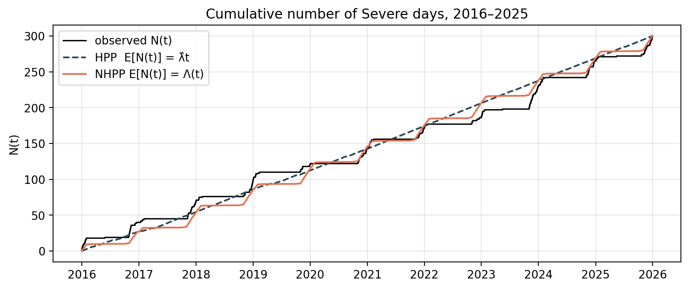

### 3.6 Trend Analysis — No Trend Detected

A Poisson regression with month and year effects: after allowing for overdispersion (quasi-Poisson, $\hat{\phi} = 1.54$), the year effect is not significant ($p = 0.10$). The linear trend is **−0.4% per year (95% CI: −5.6% to +5.0%)**.

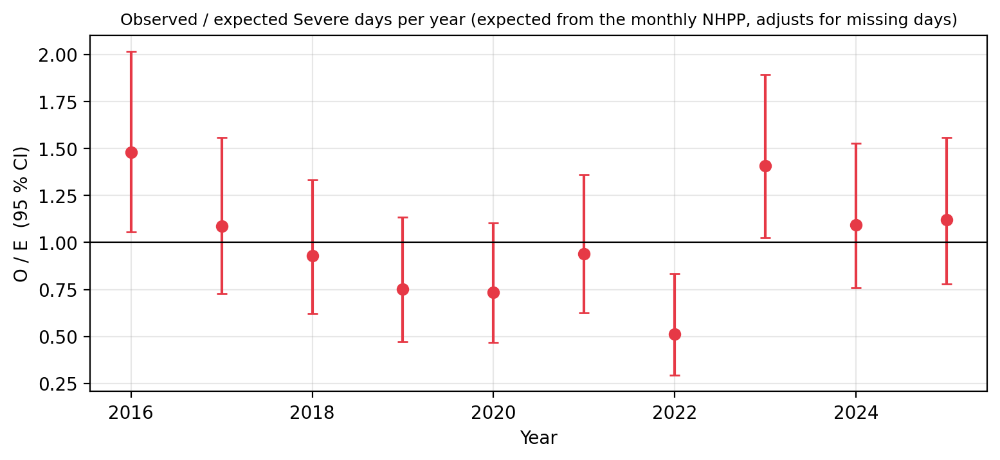

### 3.7 Clustering and Episode Analysis

**63% of Severe days (188 of 300) immediately follow another Severe day.**

- Episode onsets behave like a Poisson process: dispersion index = 0.89 ($p = 0.71$)
- Episode lengths are roughly geometric with $\hat{q} = 0.627$ (= $P(\text{Severe tomorrow} \mid \text{Severe today})$), although a chi-square test against the geometric shape gives $p = 0.018$ and the longest episode is 17 days
- This motivates the Markov chain model

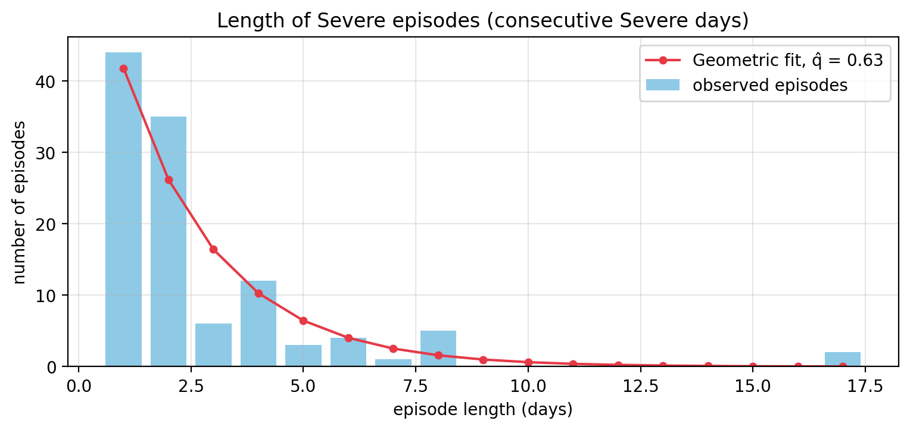

**Time-Rescaling Theorem Verification:**

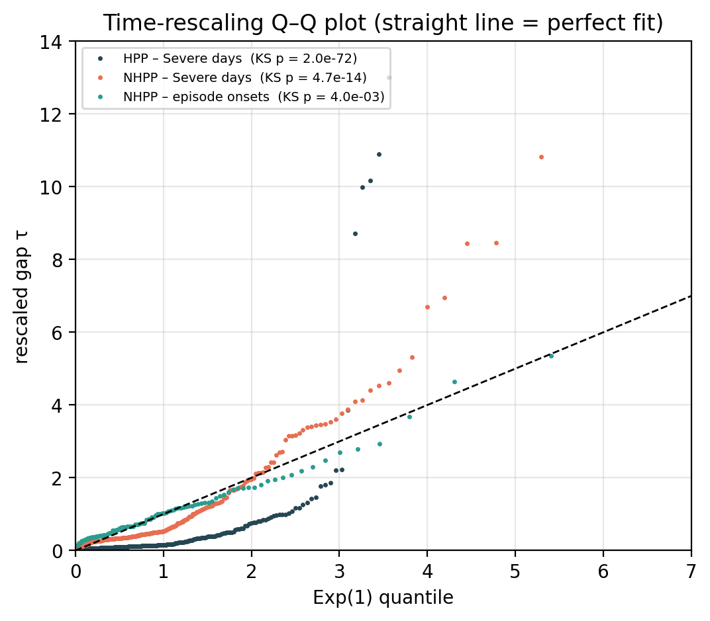

| Model | KS Distance | $p$-value |
|---|---|---|
| HPP – Severe days | 0.51 | $\approx 0$ |
| NHPP – Severe days | 0.23 | $\approx 10^{-14}$ |
| **NHPP – Episode onsets** | **0.17** | **0.004** |

Seasonality is fixed by the NHPP, but clustering of individual Severe days is not.

### 3.8 Simulation (2,000 Replications)

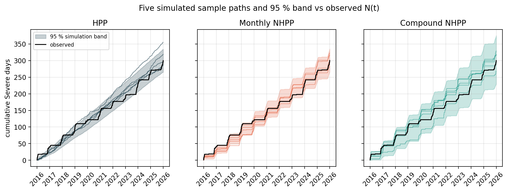

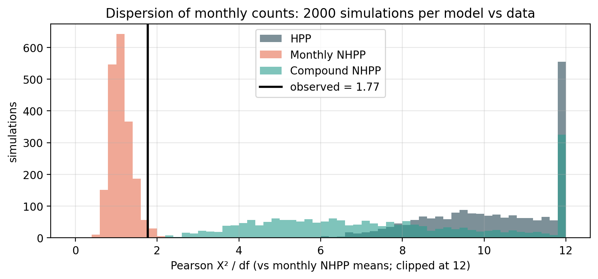

| Model | Simulated Total (Mean, 95% Range) | Monthly Dispersion $D$ (Mean, 95% Range) | $P(D_{\text{sim}} \geq D_{\text{obs}})$ |
|---|---|---|---|
| HPP | 299.6 (266–334) | 10.7 (7.0–15.8) | 1.00 |
| Monthly NHPP | 300.7 (267–335) | 1.1 (0.7–1.7) | 0.02 |
| Compound NHPP | 299.2 (230–377) | 8.1 (3.0–18.2) | 1.00 |

The NHPP is slightly too regular; the compound model is far too variable. (Section 5.4 repeats this with the shared simulation engine and a different random seed; the numbers agree to within simulation error.)

### 3.9 Out-of-Sample Validation (Trained on 2016–2022)

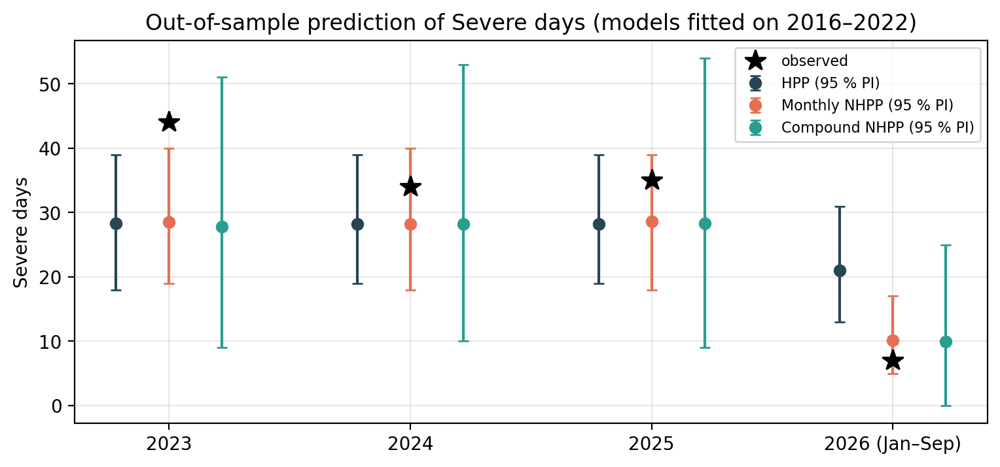

| Year | Observed | HPP 95% PI | Monthly NHPP 95% PI | Compound 95% PI |
|---|---|---|---|---|
| 2023 | 44 | 18–39 ✗ | 19–40 ✗ | 9–51 ✓ |
| 2024 | 34 | 19–39 ✓ | 18–40 ✓ | 10–53 ✓ |
| 2025 | 35 | 19–39 ✓ | 18–39 ✓ | 9–54 ✓ |
| 2026 (Jan–Sep) | 7 | 13–31 ✗ | 5–17 ✓ | 0–25 ✓ |

**Monthly prediction accuracy (45 test months):**

| Metric | HPP | **Monthly NHPP** | Compound |
|---|---|---|---|
| 95% PI Coverage | 0.80 | **0.956** | 0.978 |
| Mean Log Score | −3.36 | **−0.99** | −1.05 |
| Mean Absolute Error | 3.76 | **1.09** | 1.32 |

> [!TIP]
> The monthly NHPP achieves near-nominal 95.6% coverage, the best log score and the lowest error. Its only miss is the unusually bad winter of 2023 (44 observed vs an upper bound of 40).

---

## 4. Model II — Markov Chain (Vivian Mathew)

### 4.1 Motivation

The Poisson analysis shows that Severe days are not independent: 63% of them follow another Severe day. A Poisson process can say *how many* Severe days a month will have, but not *which* days. A Markov chain models exactly this day-to-day persistence and uses the full range of air-quality categories.

### 4.2 Formulation

The process $\{X_n\}$ is a time-homogeneous first-order Markov chain on 5 states (Good and Satisfactory merged):

$$P(X_{n+1} = j \mid X_n = i, X_{n-1}, \ldots) = p_{ij}$$

| Property | Formula |
|---|---|
| $n$-step transitions | $P^{(n)} = P^n$ (Chapman–Kolmogorov) |
| Stationary distribution | $\pi = \pi P$; $p^{(n)}_{ij} \to \pi_j$ as $n \to \infty$ |
| Spell length in state $i$ | $D_i \sim \text{Geometric}(1 - p_{ii})$; $E[D_i] = 1/(1 - p_{ii})$ |
| Mean first-passage time | $m = (I - Q)^{-1}\mathbf{1}$, $Q$ = $P$ without Severe row/column |

The MLE of each transition probability is $\hat{p}_{ij} = n_{ij}/n_i$ (maximise $\prod p_{ij}^{n_{ij}}$ subject to $\sum_j p_{ij} = 1$).

### 4.3 Estimated Transition Matrix (2016–2025, 3,394 transitions)

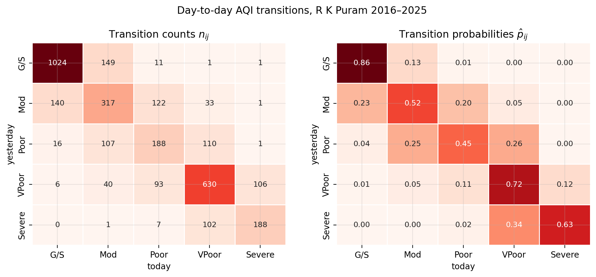

| From \ To | G/S | Moderate | Poor | Very Poor | Severe | $n_i$ |
|---|---|---|---|---|---|---|
| **G/S** | **0.863** | 0.126 | 0.009 | 0.001 | 0.001 | 1,186 |
| **Moderate** | 0.228 | **0.517** | 0.199 | 0.054 | 0.002 | 613 |
| **Poor** | 0.038 | 0.254 | **0.445** | 0.261 | 0.002 | 422 |
| **Very Poor** | 0.007 | 0.046 | 0.106 | **0.720** | 0.121 | 875 |
| **Severe** | 0.000 | 0.003 | 0.023 | 0.342 | **0.631** | 298 |

Only 3.5% of days move two or more categories in one step.

> [!NOTE]
> **Consistency check with the Poisson model:** $\hat{p}_{SS} = 188/298 = 0.631$ (95% Wilson CI: 0.575–0.684). Harsh Raj's episode analysis gave $\hat{q} = 0.627$. The two estimates agree because they count the same thing: of the 300 Severe days, $300 - 112 = 188$ were followed by another Severe day; the Markov estimate divides by the 298 Severe days with an observed next day, the episode estimate by all 300. This confirms that the two analyses are consistent; it is not independent evidence. The implied mean Severe spell $1/(1-0.631) = 2.71$ days matches the mean episode length of 2.68 days.

### 4.4 Seasonal Transition Matrices

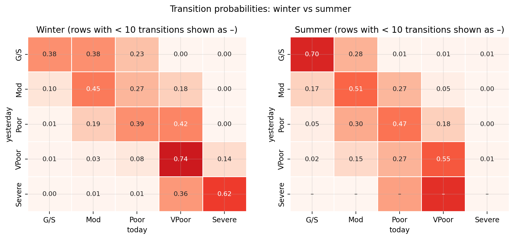

Likelihood-ratio test of equal matrices across seasons: $G^2 = 347$, df = 54, $p \approx 10^{-44}$. Winter vs summer alone: $G^2 = 136$, df = 18, $p \approx 10^{-20}$.

| Transition | Winter (Dec–Feb) | Summer (Mar–May) |
|---|---|---|
| Very Poor → Very Poor | 0.74 | 0.55 |
| Very Poor → Severe | 0.14 | 0.01 |
| Severe → Severe | 0.63 | — (only 3 Severe days) |

In winter the chain drifts towards Very Poor and Severe; in summer it drifts down. Seasons change how easily the chain **enters** Severe, not how long it **stays**.

### 4.5 Multi-Step Probability Decay

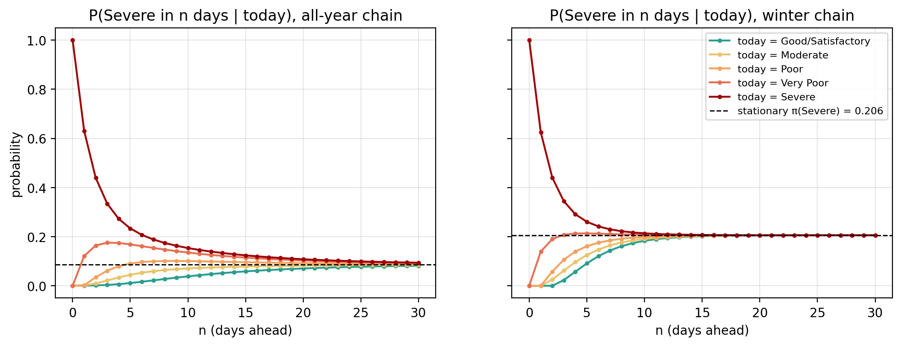

Starting from a Severe winter day:

| Days Ahead | 1 | 2 | 3 | 7 | 14 | 30 |
|---|---|---|---|---|---|---|
| $P(\text{Severe})$ | 0.63 | 0.44 | 0.34 | 0.23 | 0.21 | 0.21 |

Memory half-life (from the second eigenvalue): about 2 days in winter ($|\lambda_2| = 0.70$), about 6 days all-year ($|\lambda_2| = 0.90$).

### 4.6 Stationary Distribution

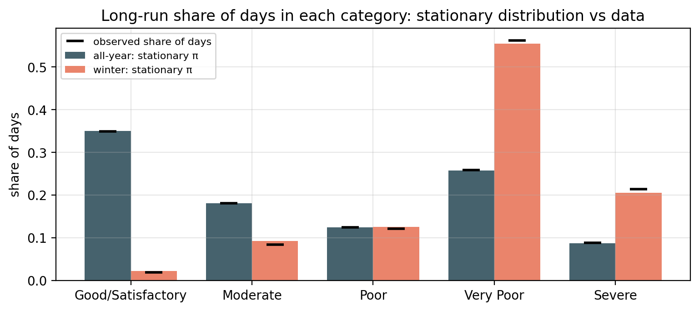

| State | All-Year $\pi$ | All-Year Observed | Winter $\pi$ | Winter Observed |
|---|---|---|---|---|
| G/S | 0.350 | 0.350 | 0.022 | 0.019 |
| Moderate | 0.181 | 0.181 | 0.092 | 0.084 |
| Poor | 0.124 | 0.124 | 0.125 | 0.121 |
| Very Poor | 0.258 | 0.258 | 0.555 | 0.563 |
| **Severe** | **0.087** | **0.087** | **0.206** | **0.214** |

Mean recurrence time of Severe: $1/\pi_5 = 11.5$ days (all-year), essentially the same quantity as $1/\hat{\lambda} = 3{,}430/300 = 11.4$ days from the Poisson analysis. **One winter day in five is Severe** in the long run.

### 4.7 Spell Lengths

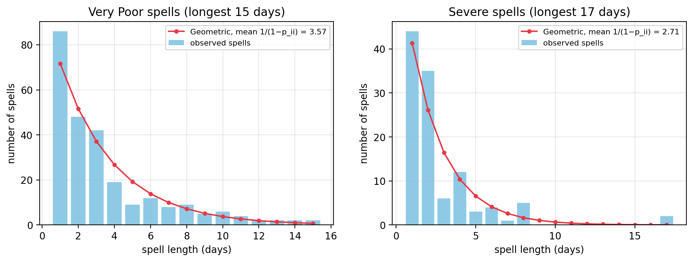

| State | Geometric Mean $1/(1-\hat{p}_{ii})$ | Observed Mean | Longest |
|---|---|---|---|
| Good/Satisfactory | 7.3 | 6.9 | 134 |
| Moderate | 2.1 | 2.0 | 13 |
| Poor | 1.8 | 1.8 | 7 |
| Very Poor | 3.6 | 3.5 | 15 |
| Severe | 2.7 | 2.7 | 17 |

Geometric spell-length predictions match the observed means for every state.

### 4.8 First Passage Time to Severe

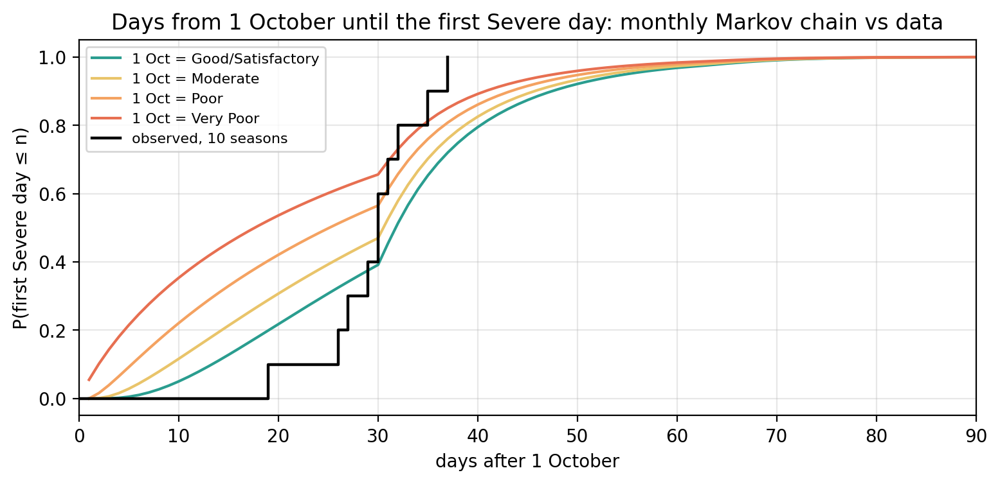

Using monthly transition matrices from **1 October**, the chain predicts the first Severe day of the season after about **29 days** from a Moderate start (the typical 1 October state). In the 10 observed seasons the first Severe day came 19–37 days after 1 October (**mean 29.6**, median 30), and all 10 had a Severe day by 15 November (model: 87–93%). The model gets the typical date right, but real start dates are more tightly bunched: a single October matrix spreads the late-October Diwali and crop-burning spike over the whole month.

Mean first-passage times to Severe for chains that stay in one regime (so the winter column assumes winter has already set in):

| From | All-Year chain | Winter chain | Post-Monsoon chain |
|---|---|---|---|
| Good/Satisfactory | 53.0 days | 15.6 days | 23.4 days |
| Moderate | 46.5 | 14.4 | 18.6 |
| Poor | 39.6 | 13.2 | 13.5 |
| Very Poor | 27.5 | 10.2 | 9.3 |

### 4.9 Order of the Chain

Anderson–Goodman likelihood-ratio tests:

| Data | Order 0 vs 1 | Order 1 vs 2 |
|---|---|---|
| Pooled 2016–2025 | $p \approx 0$ | $p \approx 10^{-12}$ |
| **Winter** | $p \approx 10^{-100}$ | **$p = 0.69$** ✓ |
| **Post-monsoon** | $p \approx 10^{-148}$ | **$p = 0.09$** ✓ |

Within winter and post-monsoon (which contain virtually all Severe days), **first order is adequate**; the pooled test rejects first order only because it mixes seasons. BIC picks order 1. Two consecutive Severe days do not make a third more likely ($P(S \mid S,S) = 0.65$ vs $P(S \mid \text{not } S, S) = 0.61$; Fisher $p = 0.53$).

### 4.10 Out-of-Sample Validation

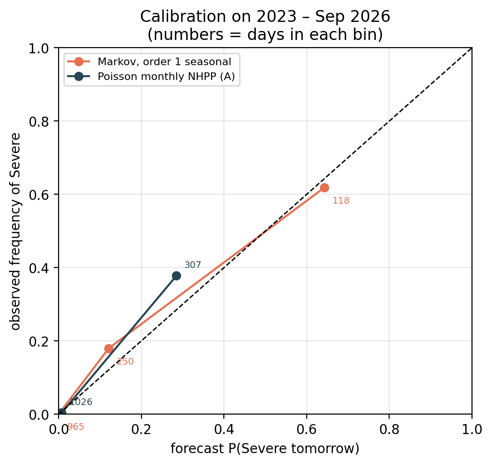

Fitted on **2016–2022**, tested on 2023–Sep 2026 (1,333 transitions, 120 Severe days):

| Model | Mean Log Score | Accuracy | Brier $P(\text{Severe})$ |
|---|---|---|---|
| Monthly category frequencies | −1.042 | 0.551 | 0.0598 |
| Order 1, all-year | −0.903 | 0.647 | 0.0521 |
| **Order 1, seasonal** | **−0.853** | **0.646** | **0.0508** |
| Order 2, seasonal | −0.898 | 0.630 | 0.0509 |
| Monthly NHPP (Section 3) | — | — | 0.0598 |

> [!TIP]
> The seasonal first-order Markov chain is the best model for next-day forecasts, beating the NHPP (Brier 0.051 vs 0.060) because it uses today's state. Section 5.7 shows that this advantage holds only one day ahead.

---

## 5. Model III — Simulation Engine & Validation (Rudraksh Kapil)

### 5.1 Simulation Engine Architecture

Rudraksh Kapil combined both models in one simulation engine (`StochasticAirQualitySimulator`, notebook 04) supporting:

1. **Markov chains**: homogeneous all-year, seasonal, and monthly non-homogeneous
2. **Poisson processes**: HPP, monthly NHPP, and compound NHPP
3. **Calendar alignment**: simulations are mapped onto the same 3,653-day study calendar, preserving leap years, season changes and the historical missing-data mask

Markov paths are advanced for all replications at once by inverse-CDF sampling: for each path, take the row of the current matrix for today's state, form its cumulative sum, and choose the first state whose cumulative probability exceeds a uniform draw.

### 5.2 Parameter Recovery Verification

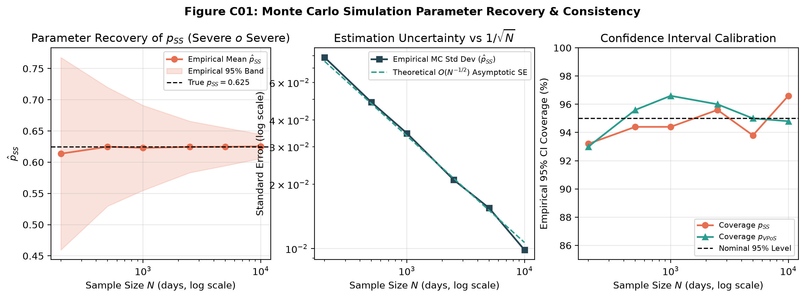

Monte Carlo parameter recovery (500 replicates per sample size, true $p_{SS} = 0.625$):

| Sample Size $N$ | Mean $\hat{p}_{SS}$ | Bias | Empirical SD | 95% CI Coverage |
|---|---|---|---|---|
| 200 | 0.614 | −0.011 | 0.079 | 93.2% |
| 500 | 0.625 | −0.000 | 0.049 | 94.4% |
| 1,000 | 0.623 | −0.002 | 0.035 | 94.4% |
| 2,500 | 0.625 | −0.001 | 0.021 | 95.6% |
| 5,000 | 0.625 | −0.000 | 0.016 | 93.8% |
| 10,000 | 0.625 | +0.000 | 0.010 | 96.6% |

The bias vanishes as $N$ grows, the standard deviation falls roughly as $N^{-1/2}$ (0.079 → 0.010 as $N$ rises fifty-fold), and interval coverage stays close to the nominal 95% (93–97%, within Monte Carlo error for 500 replicates).

### 5.3 Comparative Sample Paths

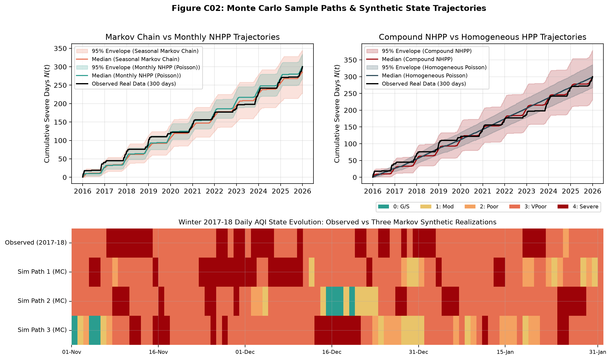

- **HPP**: a straight diagonal — misses the winter jumps and summer plateaus
- **Monthly NHPP**: follows the annual staircase, with too little variation between realisations
- **Compound NHPP**: reproduces clustering but with far too much variation
- **Seasonal Markov chain**: realistic multi-day winter bursts with proper seasonal transitions

### 5.4 Monthly Dispersion: No Model Matches

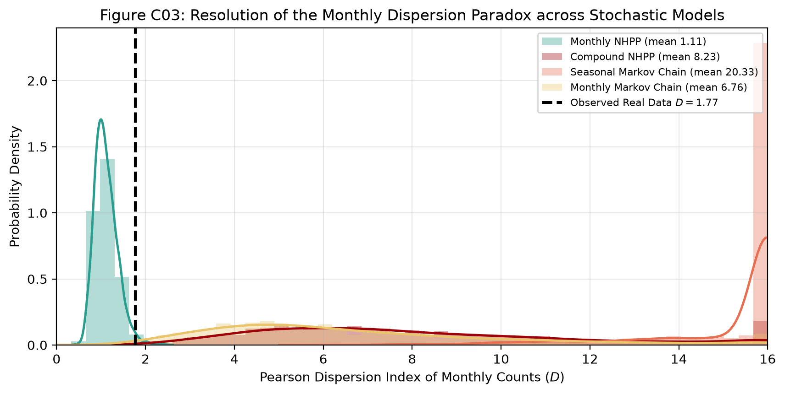

Observed monthly dispersion: $D_{\text{obs}} = 1.77$, where

$$D = \frac{1}{M-k} \sum_{m=1}^{M} \frac{(n_m - \mu_m)^2}{\mu_m}$$

with $\mu_m$ the monthly NHPP expectation (months with $\mu_m = 0$ excluded).

| Model | Simulated Total (95% range) | Monthly $D$ (Mean, 95% range) | $P(D_{\text{sim}} \geq D_{\text{obs}})$ | Verdict |
|---|---|---|---|---|
| **Real data** | **300** | **1.77** | — | — |
| HPP | 300 (267–336) | 10.6 (7.2–15.2) | 1.000 | Far too variable (ignores seasons) |
| Monthly NHPP | 301 (269–334) | 1.1 (0.7–1.7) | 0.015 | Too regular |
| Compound NHPP | 300 (231–379) | 8.2 (3.0–18.9) | 1.000 | Far too variable |
| Seasonal Markov chain | 287 (228–345) | 20.3 (9.9–35.1) | 1.000 | Far too variable |
| Monthly Markov chain | 299 (245–354) | 6.8 (2.4–15.8) | 0.996 | Too variable |

**No model reproduces the observed dispersion.** The NHPP has no memory, so its monthly counts are too steady. A first-order chain has lag-$k$ autocorrelation $\rho_k = \rho^k$ with $\rho = p_{SS} - p_{\bar{S}S}$ (about $0.625 - 0.097 \approx 0.53$ in winter), which inflates the variance of a month's count by roughly $(1+\rho)/(1-\rho) \approx 3.2$; whole spells then pile into single months. The data sit in between: real Severe days cluster within a spell, but spells are spread more evenly across a winter than a simple chain expects. This points to a model in which the intensity itself varies from winter to winter (Section 9).

### 5.5 Episode Lengths

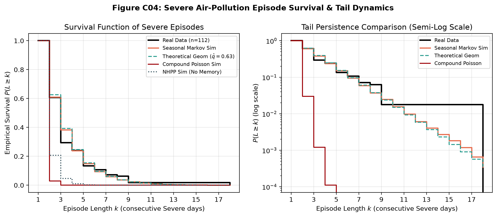

| Episode Length $k$ | Real $P(L \geq k)$ (112 episodes) | Geometric $q^{k-1}$, $q = 0.627$ |
|---|---|---|
| $\geq 2$ | 0.607 | 0.627 |
| $\geq 3$ | 0.295 | 0.393 |
| $\geq 5$ | 0.134 | 0.154 |
| $\geq 7$ | 0.071 | 0.061 |
| $\geq 10$ | 0.018 (2 episodes) | 0.015 |

**Goodness of fit (Markov chain vs real):** simulated mean episode length 2.64 days vs 2.68 observed; two-sample KS $D = 0.089$, $p = 0.32$, so the simulated and real episode lengths cannot be told apart. The independent NHPP produces far too few long episodes.

The compound NHPP's episode lengths are not compared here: in the current simulator all of an episode's days are placed on its onset day, so its episode-length test (KS $p < 10^{-50}$ in notebook 04) is an artefact of the code, not a property of the model.

### 5.6 Extreme Spells — Longest Winter Run

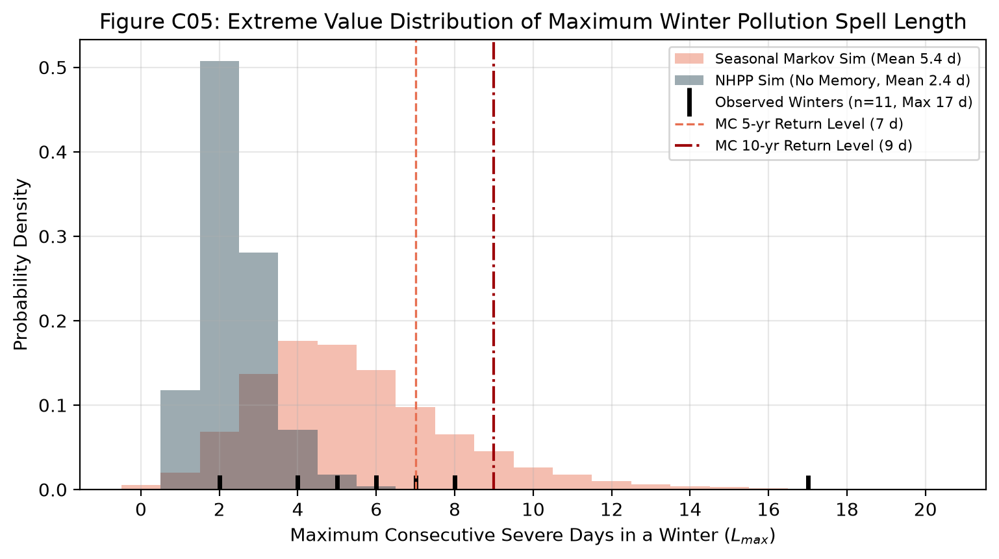

Longest run of consecutive Severe days in each December–February winter (11 real winters, 2015/16–2025/26; 20,000 simulated 90-day winters per model, the chain started from its winter stationary distribution):

| Metric | Real Winters (n = 11) | Winter Markov Chain | Monthly NHPP |
|---|---|---|---|
| Mean longest winter run | **6.3 days** | 5.9 days | 3.2 days |
| $P(\text{run} \geq 7 \text{ days})$ | 36% (4 of 11) | 33% | 1.0% |
| $P(\text{run} \geq 10 \text{ days})$ | 9% (1 of 11) | 8.6% | 0.04% |
| $P(\text{run} \geq 17 \text{ days})$ | 1 of 11 | 0.25% | ≈ 0 |

> [!NOTE]
> Without memory, a week-long Severe run happens in about 1% of winters; the Markov chain gives 33%, close to the observed 4 of 11 winters. But the chain still makes the 17-day record (from 20 December 2018) a roughly 1-in-400-winter event, so the real tail is heavier than either model. With only 11 winters we do not estimate return levels beyond the length of the record.

### 5.7 Multi-Step Forecast Verification (2023–2026)

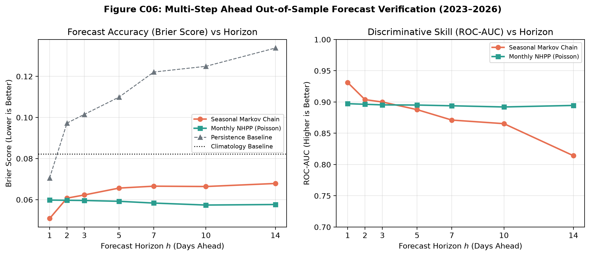

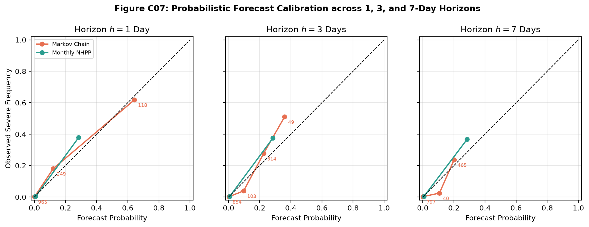

Both models are refitted on 2016–2022. The Markov forecast is

$$P(X_{t+h} = \text{Severe} \mid X_t = i) = [P_{\text{season}}^h]_{i, \text{Severe}},$$

and the NHPP forecast is the monthly rate of the target day.

| Horizon $h$ | Brier (Markov) | Brier (NHPP) | BSS vs climatology (Markov / NHPP) | AUC (Markov) | AUC (NHPP) |
|---|---|---|---|---|---|
| 1 day | **0.0508** | 0.0598 | **38.2%** / 27.3% | **0.931** | 0.897 |
| 2 days | 0.0608 | **0.0597** | 25.9% / **27.1%** | **0.904** | 0.896 |
| 3 days | 0.0623 | **0.0596** | 23.7% / **27.0%** | **0.900** | 0.895 |
| 5 days | 0.0657 | **0.0592** | 18.9% / **26.8%** | 0.888 | **0.895** |
| 7 days | 0.0666 | **0.0584** | 16.2% / **26.5%** | 0.871 | **0.894** |
| 10 days | 0.0664 | **0.0574** | 14.6% / **26.2%** | 0.865 | **0.892** |
| 14 days | 0.0679 | **0.0577** | 13.7% / **26.7%** | 0.814 | **0.895** |

The Markov chain has the lower Brier score **only one day ahead**; from two days on the monthly NHPP is better. The chain ranks days better (higher AUC) up to three days ahead. The reason is Chapman–Kolmogorov convergence: $P^h \to \pi$ within about a week, so the chain forgets today's state, while the NHPP keeps finer monthly detail. Use the chain for tomorrow and the NHPP beyond that.

### 5.8 GRAP Policy Scenarios (Assumed Effects)

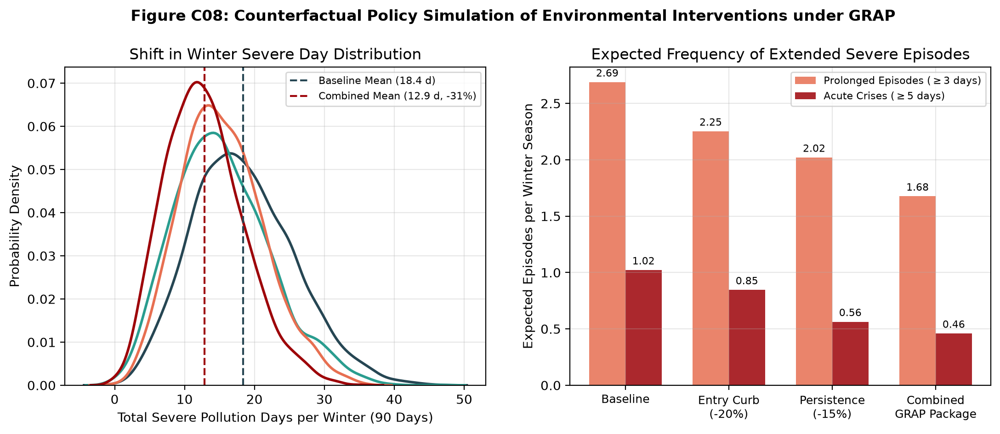

3,000 simulated 90-day winters per scenario, using the winter matrix. **The effect sizes below are assumptions chosen to illustrate the mechanism, not estimates of what GRAP achieves.**

| Scenario | Winter Severe Days (Mean ± SD) | Change | Episodes ≥ 3 days | Crises ≥ 5 days | $P(\geq 1 \text{ crisis})$ |
|---|---|---|---|---|---|
| **Baseline** | 18.4 ± 7.2 | — | 2.69 | 1.02 | 66.3% |
| Entry curb (−20% Very Poor → Severe) | 15.5 ± 6.8 | −16.0% | 2.25 (−16.2%) | 0.85 (−17.3%) | 58.8% |
| Persistence curb (−15% Severe → Severe) | 15.4 ± 6.0 | −16.1% | 2.02 (−24.8%) | 0.56 (−44.8%) | 44.3% |
| **Both** | **12.9 ± 5.6** | **−30.1%** | **1.68 (−37.6%)** | **0.46 (−55.0%)** | **37.7%** |

> [!IMPORTANT]
> **Mechanism, not forecast:** for a similar cut in total Severe days, reducing persistence removes far more multi-day crises (−44.8% of 5-day crises) than reducing entry (−17.3%), because persistence multiplies into every extra day of a spell. Real effect sizes would have to be estimated, for example from GRAP activation dates.

---

## 6. Comparison of Theoretical and Empirical Results

### 6.1 Cross-Model Consistency

| Quantity | Poisson (Harsh Raj) | Markov (Vivian Mathew) | Simulation (Rudraksh Kapil) |
|---|---|---|---|
| $P(\text{Severe} \mid \text{Severe})$ | $\hat{q} = 188/300 = 0.627$ | $\hat{p}_{SS} = 188/298 = 0.631$ | Recovered without bias (Section 5.2) |
| Mean Severe spell | 2.68 days | 2.71 days | 2.64 days (simulated) |
| Mean recurrence time | $1/\hat{\lambda} = 11.4$ days | $1/\pi_5 = 11.5$ days | — |
| Annual total | 31.9/year | $365 \times \pi_5 = 31.7$ | 300.7 per 10 years (NHPP) |

The Poisson and Markov columns agree because they are computed from the same 300 Severe days: they confirm that the two analyses are coded consistently, not that two independent methods found the same answer.

### 6.2 Theoretical Predictions vs Empirical Observations

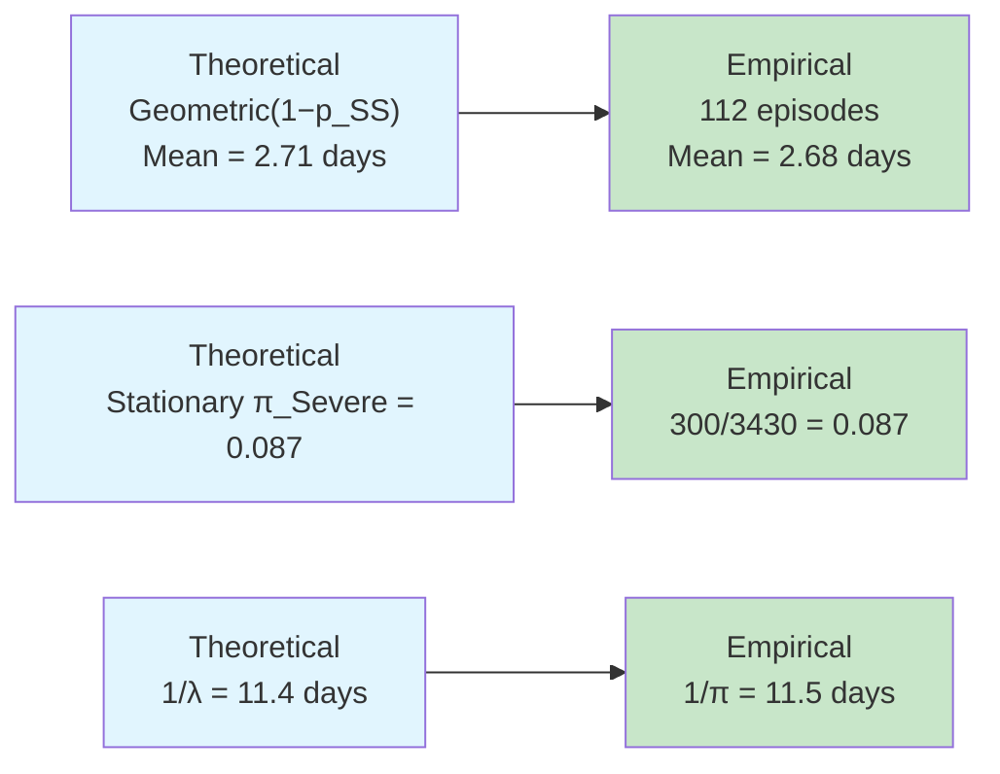

| Theoretical Prediction | Empirical Result | Agreement |
|---|---|---|
| Geometric spell lengths $E[D] = 1/(1-p_{ii})$ | Matches for all 5 states (Section 4.7) | ✓ Good |
| Stationary distribution $\pi = \pi P$ | Matches observed frequencies within 1% | ✓ Good |
| $P^n$ convergence rate (eigenvalue 0.70 in winter) | Memory half-life about 2 days, gone by 14 days | ✓ Consistent |
| NHPP 95% monthly PI coverage (nominal 95%) | Empirical coverage = 95.6% (45 months) | ✓ Good |
| No linear trend in Severe rate | −0.4%/yr, CI includes zero | ✓ Confirmed |
| First-order Markov sufficient within seasons | Anderson–Goodman $p = 0.69$ (winter) | ✓ Confirmed |
| First Severe day about 29 days after 1 Oct | Observed mean = 29.6 days (10 seasons) | ✓ Good |
| MLE standard error decays as $N^{-1/2}$ | Monte Carlo recovery confirms it | ✓ Verified |
| Markov episode lengths match real episodes | KS $D = 0.089$, $p = 0.32$ | ✓ Good fit |

### 6.3 Where Theory and Data Diverge

| Discrepancy | Model Expectation | Empirical Reality | Explanation |
|---|---|---|---|
| Monthly dispersion | NHPP $D \approx 1.1$; Markov $D \approx 6.8$ | $D_{\text{obs}} = 1.77$ | Clustering within spells, but spells spread more evenly across a winter than a chain implies |
| Spell-length shape | Geometric: $P(L \geq 3) = 0.39$ | Observed 0.30; chi-square $p = 0.018$ | Fewer medium spells than geometric; longest 17 days |
| Longest winter run | Markov: $P(\geq 17) \approx 0.25\%$ | 17-day run in 1 of 11 winters | Heavier extreme tail than the chain allows |
| 2023 winter | NHPP 95% PI: 19–40 | Observed: 44 | Year-to-year meteorological variation exceeds the Poisson range |
| Compound Poisson | Episodes add independently | Monthly $D = 8.2$ vs 1.77 | Far too variable |

### 6.4 Model Selection Summary

| Question | Best Model | Why |
|---|---|---|
| How many Severe days per month/winter? | **Monthly NHPP** | Best coverage (95.6%), lowest MAE (1.09), best log score |
| Will tomorrow be Severe? | **Seasonal Markov chain** | Uses today's state; Brier 0.051 vs 0.060 (NHPP) |
| Severe in 2 or more days' time? | **Monthly NHPP** | Lower Brier score from $h = 2$ (Section 5.7) |
| How long will a Severe spell last? | **Markov chain** | Episode lengths match (KS $p = 0.32$); NHPP gives almost no long runs |
| Chance of a week-long winter crisis? | **Winter Markov chain** | 33% vs 36% observed; NHPP 1% |
| Policy what-if? | **Markov simulation** | Direct control of entry and persistence probabilities (effects assumed) |

---

## 7. Interpretation in the Context of Application

### 7.1 Environmental & Public Health Implications

1. **Severe days are a winter phenomenon.** 94% of Severe days occur in November–January, driven by winter meteorology (low mixing height, calm winds) combined with post-harvest crop burning. This is not a year-round random risk but a predictable seasonal crisis.

2. **No improvement over the decade.** Despite GRAP and other measures, the linear trend in Severe-day rates is −0.4% per year (95% CI: −5.6% to +5.0%), statistically indistinguishable from zero at this station.

3. **Severe days cluster.** With a persistence probability of 0.63, once air quality reaches Severe it stays there for 2.7 days on average, and in about one winter in three there is a run of a week or more. Multi-day crises have cumulative health impacts beyond isolated bad days.

4. **One winter day in five is Severe.** The winter stationary distribution gives a Severe day about every 5 days on average; in the worst winters, runs of 10–17 consecutive Severe days occur.

### 7.2 Policy Decision Support

The policy scenarios use **assumed** effect sizes, so they show mechanisms rather than predictions:

- **Shortening spells matters most for the worst episodes.** A 15% cut in Severe persistence removes about 45% of 5-day crises, about 2.6 times the effect of a 20% cut in the chance of entering Severe.
- **Combined measures add up.** Applying both assumed effects cuts winter Severe days by about 30% and 5-day crises by about 55%.
- **The season's start is predictable.** The first Severe day typically arrives about 29–30 days after 1 October (late October to early November), giving a window to prepare emergency measures.

### 7.3 Complementary Models for Different Decisions

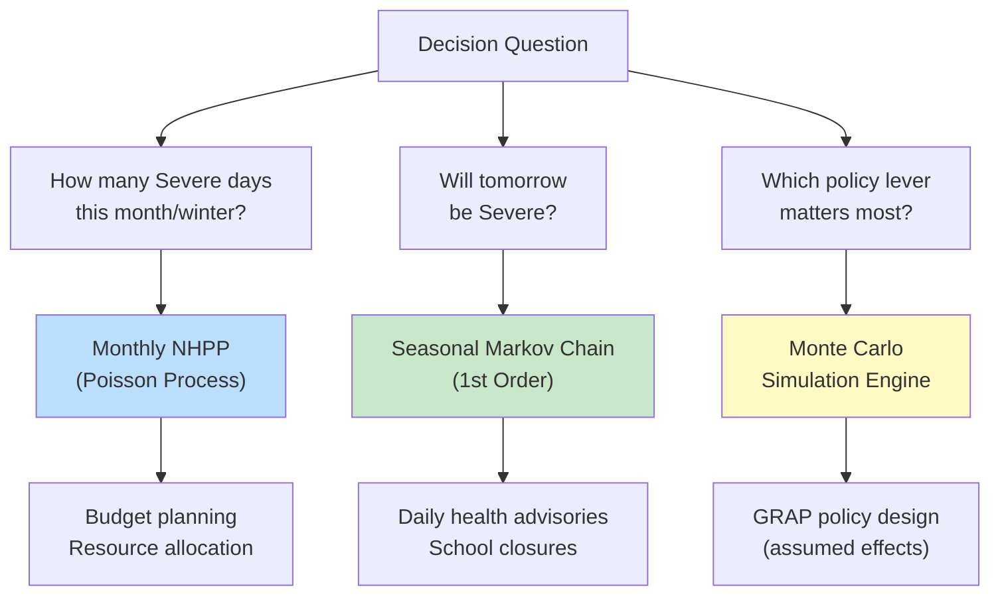

---

## 8. Limitations

### 8.1 Data Limitations
- **Single station:** R K Puram is one residential site in south Delhi; other parts of Delhi and the wider NCR may behave differently
- **Daily resolution:** At most one event per day, so the Poisson process is an approximation
- **Missing data:** 6.1% of days missing and 5.3% interpolated; interpolation can create or remove threshold crossings
- **Short record:** 10 years (11 December–February winters) limits extreme-value estimation

### 8.2 Model Limitations
- **No weather covariates:** The models are purely statistical; wind speed, mixing height, temperature inversions and regional fire counts are not included, so they describe patterns rather than causes
- **Constant matrices within seasons:** Transition matrices are constant within each season or month; in reality conditions change sharply (for example, October starts clean and ends Severe)
- **Year-to-year variability:** 2022 (clean) and 2023 (44 Severe days) fall outside the Poisson model's range; the Markov chain covers them but is too bursty month to month, so neither model gets year-to-year variation right
- **Monthly dispersion:** No model reproduces the observed dispersion of 1.77 (Section 5.4)
- **Threshold sensitivity:** Categories ignore how far PM2.5 is within a class (251 and 700 µg/m³ are both "Severe")
- **First-order assumption:** Justified within seasons; the pooled data show second-order effects only because they mix seasons

### 8.3 Policy Simulation Limitations
- **Assumed effects:** The scenarios assume specific percentage changes in transition probabilities; these are not estimated and may not match what real interventions achieve
- **No behavioural response:** Real interventions may change behaviour in ways not captured by changing a transition matrix

### 8.4 Code Issue to Fix
- The compound NHPP simulator in notebook 04 places all of an episode's days on its onset day, so episode-length comparisons for that model are not valid (Section 5.5). Its total and monthly-dispersion results are unaffected.

---

## 9. Possible Extensions

| Extension | Description | Benefit |
|---|---|---|
| **Weather covariates** | Poisson regression or multinomial-logistic Markov chain with boundary-layer height, wind speed and fire counts | Better day-to-day predictions; causes, not just patterns |
| **Cox (doubly stochastic) process** | Random intensity to capture year-to-year variation (e.g. 2023) | More realistic uncertainty and dispersion |
| **Hawkes (self-exciting) process** | Self-exciting kernel for clustering without the Markov assumption | Flexible clustering model |
| **Hidden Markov model** | Latent meteorological regimes (e.g. inversion/ventilation) driving observed AQI | Regime identification |
| **Continuous-state model** | Autoregressive model for $\log(\text{PM2.5})$ instead of categories | Uses the full concentration information |
| **Spatial model** | Multi-station analysis across Delhi NCR | Spatial risk assessment |
| **Weekly-varying Markov chain** | Transition matrices that change within October–November | Sharper season-start predictions |
| **Estimated policy effects** | Compare transitions before and after real GRAP activation dates | Replace assumed effects with estimates |
| **Bayesian framework** | Prior information and posterior updating for real-time forecasting | Online decision support |

---

## 10. References

1. Anderson, T. W., Goodman, L. A. (1957), "Statistical inference about Markov chains", *Annals of Mathematical Statistics* 28(1), 89–110.
2. Achcar, J. A., Fernández-Bremauntz, A. A., Rodrigues, E. R., Tzintzun, G. (2008), "Estimating the number of ozone peaks in Mexico City using a non-homogeneous Poisson model", *Environmetrics* 19(5), 469–485.
3. Asmussen, S. (2003), *Applied Probability and Queues*, Springer.
4. Brier, G. W. (1950), "Verification of forecasts expressed in terms of probability", *Monthly Weather Review* 78(1), 1–3.
5. Brown, E. N., Barbieri, R., Ventura, V., Kass, R. E., Frank, L. M. (2002), "The time-rescaling theorem and its application to neural spike train data analysis", *Neural Computation* 14(2), 325–346.
6. Central Pollution Control Board, *National Air Quality Index* (2014) — AQI breakpoints.
7. CPCB CCR, *CAAQMS Data Repository*, https://airquality.cpcb.gov.in/ccr/ (accessed Oct 2026).
8. Coles, S. (2001), *An Introduction to Statistical Modeling of Extreme Values*, Springer.
9. Commission for Air Quality Management in NCR (CAQM) (2022), *Graded Response Action Plan (GRAP) for NCR*, Government of India.
10. Garwood, F. (1936), "Fiducial limits for the Poisson distribution", *Biometrika* 28, 437–442.
11. Guttorp, P. (1995), *Stochastic Modeling of Scientific Data*, Chapman & Hall/CRC.
12. Katz, R. W. (1981), "On some criteria for estimating the order of a Markov chain", *Technometrics* 23(3), 243–249.
13. Ross, S. M., *Introduction to Probability Models*, Academic Press.
14. Wilks, D. S. (2011), *Statistical Methods in the Atmospheric Sciences*, Academic Press.
15. World Health Organization (2021), *WHO Global Air Quality Guidelines*, Geneva.

---

## Individual Contributions

| Member | Contribution |
|---|---|
| **Harsh Raj** | Downloaded and cleaned the CPCB data and produced the shared daily dataset; exploratory analysis and threshold selection; built the homogeneous, monthly and compound Poisson models (estimation, likelihood-ratio tests, time-rescaling, simulation, out-of-sample validation) — notebooks 01–02 |
| **Vivian Mathew** | Formulated and estimated the Markov chain on AQI categories (all-year, seasonal and monthly matrices); derived $n$-step probabilities, the stationary distribution, spell lengths and first-passage times, including the season-start model; tested time-homogeneity and chain order; next-day out-of-sample validation against the Poisson model — notebook 03 |
| **Rudraksh Kapil** | Designed the shared `StochasticAirQualitySimulator`; Monte Carlo parameter recovery; dispersion and episode-length comparisons; extreme-spell analysis; multi-step forecast verification; GRAP policy scenarios — notebook 04 |
